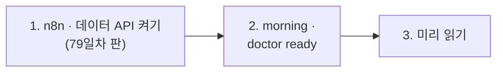

# 79일차 실습 준비 · 수업 전에 미리 해 두면 좋은 것

- 수업일: 2026-11-04 (79일차) · 운영 데이터 기반 Workflow Ops Assistant
- 준비 시간: 약 10분
- 먼저 WSL에서 `cd ~/aio-01d4-stu && git pull`로 오늘 자료를 받습니다 (수강생 저장소: https://gl.isitsoft.kr/publicproj/aio-01d4-stu).
- **수업 전날까지** 1~2절을 끝내 주세요.



---

## 1. n8n과 데이터 API 켜기 (전날 필수, 3분)

오늘은 **79일차 판 데이터 API**(78일차 + 운영 아침 상태)를 씁니다. 켜는 순간 알림 · DLQ · 품질 기록 · 사용량 · 예산 · 릴리스가 "수요일 아침 08:30" 상태로 채워집니다.

```bash
sudo systemctl disable --now ollama 2>/dev/null   # WSL에 설치한 Ollama가 있으면 끄고 자동 시작도 끔
cd ~/aio-01d4-stu/Last3Mon/65/n8n
docker compose rm -sf ollama                      # Ollama 컨테이너가 있으면 지움 (없으면 그냥 지나감)
docker compose start
cd ~/aio-01d4-stu/Last3Mon/79/data-api
docker compose up -d --force-recreate
curl -s localhost:8800/ops/seed-info               # {"seeded_at": "2026-11-04T08:30:00", ... "counts": {"alerts": 6, ...
```

- **66일차부터 LLM은 OpenAI API 키(`Last3Mon/.env`, Credential `OpenAI (.env)`)만 씁니다.** Ollama는 쓰지 않습니다.
- `network day65-n8n_default not found` → n8n이 켜져 있지 않음. 위 n8n 부분부터 다시.

## 2. 상태 보기와 준비 확인 (전날 필수, 3분)

```bash
cd ~/aio-01d4-stu/Last3Mon/79
uv run tools/flow.py push reference/baseline-ops-facts.json reference/baseline-ops-ask.json   # 팀의 기준 둘 (고치기 전에 비교할 상대)
uv run tools/flow.py morning
uv run tools/flow.py doctor
```

```text
seeded morning 2026-11-04T08:30:00 · {"alerts": 6, "dlq": 3, "quality_log": 4, "quarantine": 1, "usage": 192}
alerts: 6 (high 3)
  [high] helpdesk/Search FAQ · timeout · timeout of 1000ms exceeded
  ...
DLQ: 3 (parked 2)
quality log: 4 (scores [0, 0.8, 0.8333, 1]) · quarantine 1
usage: 156 requests · 192 calls · $0.073604
budget: used $0.073604 of $0.08
release: active 1.1.0 · canary {"release": "1.2.0", "percent": 20}
...
✔ operations morning /ops/seed-info (day 79 data API)
✔ credential 'OpenAI (.env)' (openAiCourse0001)
ready
```

| ✘ 항목 | 할 일 |
| --- | --- |
| n8n container · data API | 1절 |
| operations morning | 데이터 API가 예전 판 → 1절 `--force-recreate` |
| credential | `cd ~/aio-01d4-stu/Last3Mon/65/n8n && bash register-credentials.sh` |
| CLI coding agent | [67일차 준비](../67/00-DAY67-PREP.md) 2절 |

---

## 3. 미리 읽어 오면 좋은 내용 (선택, 약 5분)

### 3.1 "지금 괜찮아요?"

72~78일차에 운영 데이터를 많이 남겼습니다: 실행 기록 · 알림 · DLQ · 품질 기록 · 사용량 · 릴리스. 그런데 아침에 "지금 괜찮나?"에 답하려면 여섯 곳을 열어야 합니다. 오늘은 그것을 **한 번에 묻고 답하는** 운영 도우미를 만듭니다. `flow.py morning`을 보고 가장 먼저 볼 것 하나를 골라 오세요.

### 3.2 용어

| 용어 | 한 줄 설명 |
| --- | --- |
| 운영 사실 | 여러 출처를 정해진 정의로 모은 하나의 JSON (숫자는 Code가) |
| 영역 상태 | 영역마다 🔴 · 🟡 · 🟢 (규칙으로) |
| 라우터 | 질문을 보고 어느 영역의 사실을 쓸지 고르는 곳 |
| 골든 질문 | 정답(영역 · 숫자)을 알고 있는 질문 — 도우미를 시험하는 데 씀 |
| 평가 관문 | 골든 질문 점수가 기준(0.9)보다 낮으면 실패 · 알림 |
| 감사 기록 | 질문마다 영역 · 거절 이유를 남기는 한 줄 |

## 4. 당일 준비물

- 충전된 노트북과 충전기, WSL의 Docker, Windows Terminal(WSL) 창 **두 개**, 웹 브라우저
- 77 · 78일차 `~/vibe/tlog` · `~/vibe/tcheck` (7교시 `tops`에서 부품으로 부름, 없어도 됨)

## 확인

- [ ] `curl -s localhost:8800/ops/seed-info`에 `"alerts": 6`
- [ ] `flow.py morning`이 알림 · DLQ · 예산 · 카나리를 보여 줌
- [ ] `base-ops-facts` · `base-ops-ask` 게시
- [ ] `uv run tools/flow.py doctor` → 마지막 줄 `ready`
