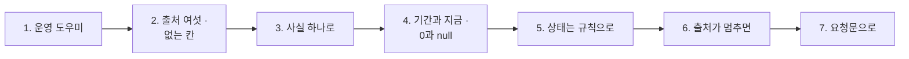

# 1단계 · 운영 사실

- 교시: 1교시 강의 (09:00~09:50) · 2교시 [Lab 01](../../Last3Mon/79/LAB-01-Q-OPS-FACTS.md) 실습 5개 (10:00~10:50)
- 이 단계가 끝나면: 운영 담당자가 아침에 묻는 것을 영역 여섯으로 나눠 말하고, 흩어진 출처를 **정의가 정해진 사실 하나**로 모으고, 기간에 따르는 숫자와 "지금" 숫자를 나누고, 0(없었음)과 `null`(모름)을 구분하고, 정해진 기준으로 영역마다 색을 매기고, 출처 하나가 멈춰도 나머지 사실을 내놓을 수 있다.
- 숫자: 모두 강사 노트북 실측입니다 (65일차 n8n 2.42.6, 79일차 판 데이터 API — 2026-11-04 08:30 운영 아침 상태, 실행 기록 666건, 11/01 실습을 5개로 늘린 뒤 정답 워크플로우를 학생 순서대로 1회). 사실 · 상태는 Code라 누가 돌려도 같습니다. 출력 전부는 수업 뒤 공개되는 `Last3Mon/79/answers/LAB-TEST-RESULT.md`에 있습니다.
- 실습 가리키기: 이 문서에서 "Lab 01 예제 1"은 2교시 [Lab 01 문서](../../Last3Mon/79/LAB-01-Q-OPS-FACTS.md)의 그 절입니다. 파일 경로(`cases/` · `requests/` · `my-work/` · `reference/`)는 실습 폴더 `~/aio-01d4-stu/Last3Mon/79` 기준입니다.

## 0. 이 시간 (50분)

| 시간 | 절 · 개요 | 하는 일 |
| --- | --- | --- |
| 09:00~09:06 | 개요 1~6장 | 오늘 하루, 수요일 아침 08:30, 실습 15개 |
| 09:06~09:13 | 1 · 개요 7장 | 운영 도우미가 하는 일 · 하지 않는 일 |
| 09:13~09:20 | 2 · 개요 8~9장 | 출처 여섯, 기준 대시보드의 없는 칸 |
| 09:20~09:28 | 3 · 개요 10장 | 사실 하나로 — 정의는 다시 만들지 않는다 |
| 09:28~09:34 | 4 · 개요 11장 | 기간과 지금, 0과 `null` |
| 09:34~09:43 | 5 · 6 · 개요 12~14장 | 상태는 규칙으로, 출처가 멈추면 |
| 09:43~09:50 | 7 · 8 · 확인 질문 | 요청문, 자주 하는 실수 |

### 2교시 Lab 01에서 이어서 하는 것

| 2교시 실습 (시각) | 이 강의의 절 | 실습에서 하는 일 | 쓰는 파일 · 명령 |
| --- | --- | --- | --- |
| 시작 (10:00) | — | 운영 도우미 설계표 복사 | `cp templates/OPS-ASSISTANT-TEMPLATE.md my-work/OPS.md` (오늘의 사실 · 기준 · 거절을 모두 여기에) |
| Lab 01 예제 1 (10:00~10:10, 에이전트 없이) | 1 · 2 | 출처를 `morning`으로 둘러보고 기준 대시보드와 비교 | `morning`, `call base-ops-facts requests/week2.json` → `OPS.md` 1절 |
| Lab 01 예제 2 (10:10~10:25) | 3 | 운영 사실 `my-ops-facts` | `my-work/ops-facts.json` (새로), 테스트 `cases/lab01.json` (전: `--webhook base-ops-facts`) |
| Lab 01 예제 3 (10:25~10:32, 에이전트 없이) | 4 | 기간을 바꾸면 | `test cases/lab01-period.json -v` → `OPS.md` 2절 |
| Lab 01 과제 1 (10:32~10:42) | 5 | 영역별 상태 | 테스트 `cases/lab01-challenge.json` → `OPS.md` 3절 |
| Lab 01 과제 2 (10:42~10:50) | 6 | 출처가 멈추면 | 테스트 `cases/lab01-challenge2.json` (사용량 출처를 멈춤) |

## 1. 운영 도우미: 아침 08:30에 묻는 것 (2교시 Lab 01 예제 1)

### 일반 설명

> **생활 속 예 · 병원 아침 인수인계.** 아침 8시 반, 밤 근무 간호사가 낮 근무에게 병동을 넘깁니다. "열이 오른 환자 둘, 수액이 끝나 가는 환자 하나, 검사 결과를 기다리는 환자 셋." 차트 열두 개를 처음부터 다 읽지 않고, **정해진 항목**을 **정해진 순서**로 말합니다. 넘겨받는 사람은 "지금 괜찮나? 무엇부터 볼까?"만 알면 됩니다. 오늘 만드는 운영 도우미가 이 인수인계입니다.

**운영 도우미(operations assistant)는 "지금 괜찮나? 무엇부터 볼까?"에 답하는 프로그램입니다.** 서비스를 운영하면 정보가 여러 곳에 흩어집니다 — 실행 기록, 울린 알림, 처리하지 못하고 쌓인 일, 데이터 품질, 쓴 비용, 지금 나가 있는 판(버전). 운영 담당자는 아침마다 이것을 하나씩 열어 봅니다. 업계에서는 이것을 한 화면 · 한 대화로 모으는 일을 이렇게 부릅니다.

| 이름 | 하는 일 | 예 |
| --- | --- | --- |
| 운영 대시보드 | 숫자 · 색을 한 화면에 | Grafana, Datadog 대시보드 |
| ChatOps | 대화창에서 운영 상태를 묻고 답을 받음 | Slack 봇, PagerDuty · Opsgenie의 Slack 연동 |
| AIOps | 운영 데이터에 AI(이상 탐지 · 요약 · 분류)를 씀 | Datadog Bits AI, Dynatrace Davis |
| 아침 브리핑 · 스탠드업 리포트 | 정해진 시간에 먼저 볼 것을 정리 | 당번 인수인계 문서 |

원칙은 하나입니다: **숫자 · 상태는 Code(프로그램)가, 글은 LLM이, 작업은 사람이.** 숫자를 세고 색을 정하는 일은 언제나 같은 답이 나와야 해서 프로그램이 하고, 사람이 읽기 좋은 문장만 LLM이 씁니다. 그리고 운영 도우미는 **읽기만** 합니다. 실패한 일을 다시 돌리거나, 새 판을 끄거나, 예산을 바꾸는 **작업**은 사람이 **런북**(runbook, "이런 일이 생기면 이렇게 한다"를 미리 적어 둔 작업 안내서)대로 합니다 (2단계).

### 오늘 실습에서

`uv run tools/flow.py morning`으로 본 2026-11-04 08:30 (Lab 01 예제 1):

| 출처 | 지금 | 남긴 날 |
| --- | --- | --- |
| 알림 | 6건 (높음 3): FAQ timeout · 429 · B-1 거절 · 낮은 점수 둘 · 접수 API 503 | 76 · 77 · 78일차 |
| DLQ | 3건, **parked 2** | 76일차 |
| 품질 기록 · 격리함 | 4줄 (점수 0 · 0.8 · 0.8333 · 1) · 격리 1 | 78일차 |
| 사용량 · 예산 | $0.073604 / $0.08 (약 92%) | 75일차 |
| 릴리스 | 1.1.0 + **카나리 1.2.0 20%** | 74일차 |
| 실행 기록 | 666건 (10/19~10/30) | 77일차 |

## 2. 출처 여섯과 기준 대시보드: 없는 칸이 가장 위험하다 (2교시 Lab 01 예제 1)

### 일반 설명

> **생활 속 예 · 체온만 적힌 인수인계 메모.** 밤 근무가 "모두 체온 정상"이라고만 적어 두었습니다. 거짓은 없습니다. 그런데 메모에 "수액" 칸이 없어서, 수액이 끝난 환자가 있다는 것을 낮 근무는 모릅니다. 틀린 숫자는 누군가 고치지만, **없는 칸**은 아무도 묻지 않습니다.

**대시보드의 실수는 두 가지입니다: 틀린 숫자와 없는 칸.** 틀린 숫자는 누군가 "이상한데?" 하고 알아챕니다. 없는 칸은 "그 영역은 괜찮다"처럼 보입니다. 그래서 운영 도우미를 만들 때는 먼저 **무엇을 물어야 하는지**(영역)를 정합니다.

| 영역 | 묻는 것 | 빠지면 |
| --- | --- | --- |
| 실행 | 오류가 늘었나, 느려졌나, 답을 못 하나 | 장애를 사용자가 먼저 앎 |
| 알림 | 무엇이 울렸나, 얼마나 급한가 | 높은 알림이 묻힘 |
| DLQ (처리하지 못한 일을 모아 두는 곳) | 사람이 볼 일이 남았나 | 접수 건이 사라짐 (76일차) |
| 품질 | 들어온 데이터를 믿을 수 있나 | 틀린 FAQ로 답함 (78일차) |
| 비용 | 한도 안인가, 누가 쓰나 | 오후에 서비스가 멈춤 (75일차) |
| 릴리스 | 지금 무슨 판(버전)이 나가나, 새 판은 괜찮나 | 일부 사용자에게 먼저 내보낸 새 판(카나리)이 나쁜데 계속 나감 (74일차) |

Google SRE의 "네 가지 황금 신호"(지연 · 트래픽 · 오류 · 포화)가 서비스 하나의 영역이라면, 오늘의 여섯은 **AI 워크플로우 운영**의 영역입니다 — 품질 · 비용 · 릴리스가 더해집니다.

### 오늘 실습에서

팀의 기준 대시보드(`base-ops-facts`)에 지난주를 물으면 (Lab 01 예제 1):

| 출처 | `morning` | 기준 대시보드 |
| --- | --- | --- |
| 실행 | (지난주 357건) | **666건** · 오류율 3.153153… (기간 무시 · 백분율) |
| 알림 · DLQ | 6 · 높음 3, 3 · parked 2 | 6, 3 (높음 · parked 없음) |
| 품질 · 릴리스 | 4줄 · 격리 1, 카나리 1.2.0 20% | **칸 없음** |

- 기준만 보는 사람은 오늘 가장 급한 둘(**parked 2건 · 카나리**)을 모릅니다.

## 3. 사실 하나로: 정의는 다시 만들지 않는다 (2교시 Lab 01 예제 2)

### 일반 설명

> **생활 속 예 · 병원 공용 차트 양식.** 간호사마다 자기 공책에 "고열"을 다르게 적으면(37.5도? 38도?) 인수인계 때마다 다툽니다. 병원은 그래서 차트 양식 하나에 "고열 = 38도 이상"을 박아 두고 모두 그것을 씁니다. 새 화면을 만들 때도 양식을 새로 쓰지 않고 그 차트를 읽습니다.

**운영 사실(facts)은 여섯 출처를 정해진 정의로 모은 JSON 하나입니다.** 다음 단계(질문 답변 · 브리핑 · 평가 · 터미널 도구)는 모두 이 사실만 읽습니다. 정의가 사실 한 곳에 있으면, 질문 답변이 말하는 오류율과 브리핑 표의 오류율이 **같습니다.** 업계에서는 지표의 정의를 한 곳에 두는 층을 **시맨틱 레이어**(semantic layer, metrics layer — dbt Semantic Layer · Cube · LookML)라고 부릅니다.

| 원칙 | 까닭 |
| --- | --- |
| 77일차 정의 그대로 (오류율 · p95 · 답 못 함) | 정의가 두 벌이면 같은 날 다른 숫자 (77일차에 겪음) |
| 비율은 0~1, 소수 4자리 | 백분율(3.15)과 비율(0.0315)을 섞으면 기준(0.01)과 비교가 틀림 |
| 계산은 Code 하나 | LLM은 숫자를 세지 않음 — 세는 순간 날마다 달라짐 |
| 출처는 읽기만 | 사실을 만드는 데 상태를 바꿀 까닭이 없음 |

### 오늘 실습에서

내 `my-ops-facts`의 지난주 (Lab 01 예제 2, `lab01` 5/5):

| 영역 | 사실 |
| --- | --- |
| 실행 | 357건 · 오류 21 · 0.0588 · p95 2598ms · 답 못 함 0.0476 · 실패 1위 `Search FAQ` timeout 16 |
| 알림 · DLQ | 6 · 높음 3 · 이유별, 3 · parked 2 · 대기 1 |
| 품질 | 4배치 · 평균 0.6583 · 마지막 1 · 거절 1 · 격리 1 |
| 비용 | 156요청 · 192호출 · $0.073604 / $0.08 = 0.9201 · 1위 `test-bot` 37% |
| 릴리스 | 1.1.0 · 카나리 1.2.0 20% · 다시 묻기 **7.73% 대 62.5%** |

- 357 · 0.0588 · 2598 · 16은 77일차 `my-log-report`의 둘째 주와 **같은 숫자**입니다. 출처 여덟을 읽어 Code 하나에서 0.1초.

## 4. 기간과 지금: 0과 `null`은 다르다 (2교시 Lab 01 예제 3)

### 일반 설명

> **생활 속 예 · "어젯밤 몇 번 열이 났나"와 "지금 체온".** 인수인계에는 두 가지 시간이 섞입니다. "밤새 열이 두 번" — 기간의 숫자. "지금 37.2도" — 지금의 숫자. 그리고 "어젯밤 소변량은 재지 않았음"은 "소변 0"과 전혀 다릅니다. 0이라고 적으면 큰일 납니다.

**숫자에는 시간의 종류가 있습니다.**

| 종류 | 뜻 | 흔한 예 |
| --- | --- | --- |
| 기간(window) 숫자 | 정한 기간에 일어난 일의 합 · 비율 | 지난주 주문 수, 지난달 오류율 |
| 지금(point-in-time) 숫자 | 바로 이 순간의 상태 | 지금 쌓여 있는 문의 수, 지금 남은 예산 |

기간을 바꾸면 **기간 숫자만** 바뀌어야 합니다. "지난달을 보여 줘"라고 했는데 지금 쌓인 문의 수까지 지난달 값으로 바뀐다면 정의가 섞인 것입니다. 보고할 때도 "실행은 지난주, 나머지는 오늘 아침 지금"처럼 두 시간을 나눠 말합니다.

그리고 **"없었다"와 "모른다"를 나눕니다.**

| 값 | 뜻 | 예 |
| --- | --- | --- |
| 0 | 셀 것이 있었고, 그 결과가 0 | 주문이 0건인 날의 오류율 = 0 |
| `null` (값 없음) | 셀 수 없었다 · 말할 수 없다 | 주문이 0건인 날의 "가장 많이 실패한 상품", 그 판이 한 번도 쓰이지 않은 날의 그 판 오류율 |

`null`을 0으로 바꾸면 "모른다"가 "좋다"로 보입니다. 다음 절의 색 판정에서 바로 문제가 됩니다. 데이터베이스의 `NULL`, 통계의 결측값(missing value)과 같은 생각입니다.

### 오늘 실습에서

같은 사실에 기간 넷 (Lab 01 예제 3, 5/5):

| 기간 | 실행 | 다시 묻는 비율 (1.1.0 · 1.2.0) | 지금 숫자 |
| --- | --- | --- | --- |
| 두 주 | 666 · 0.0315 | 7.73% · 62.5% | 그대로 |
| 하루 (10/26) | 70 · 0.2286 | **`null` · `null`** — 두 판은 10/28부터 | 그대로 |
| 빈 주 (11/02~) | 0 · 오류율 0 · p95 0 · 실패 1위 `null` | `null` · `null` | 그대로 |
| 기간 없음 | 357 (지난주) | 7.73% · 62.5% | 그대로 |

## 5. 상태는 규칙으로: 숫자에 색을 매기기 (2교시 Lab 01 과제 1)

### 일반 설명

> **생활 속 예 · 병동 현황판의 빨강 · 노랑 자석.** 현황판에 환자마다 색 자석을 붙입니다. 빨강은 "지금 가서 봐야 함", 노랑은 "오늘 안에 봐야 함". 색은 간호사의 기분이 아니라 **기준표**로 붙입니다 — "체온 38.5도 이상이면 빨강". 그래야 누가 붙여도 같은 색입니다.

**상태(health)는 숫자에 정해진 기준을 대어 영역마다 색을 매긴 것입니다.** 업계에서는 RAG 상태(Red · Amber · Green), 헬스 체크(health check), SLO 판정(77일차)이라고 부릅니다. 사람이 숫자 여섯 개를 보고 매번 "괜찮은가"를 따지지 않아도, 색만 보면 무엇부터 볼지 알 수 있습니다.

| 색 | 뜻 | 기준을 정하는 법 (예) |
| --- | --- | --- |
| 🔴 빨강 | 지금 가서 봐야 함 | 약속(SLO)을 어김, 사람이 처리해야 할 일이 남음 |
| 🟡 노랑 | 오늘 안에 봐야 함 | 약속에 가까워짐, 지켜볼 일이 생김 |
| 🟢 초록 | 괜찮음 | 위 기준에 하나도 걸리지 않음 |

기준은 숫자의 **뜻**에서 나옵니다: 오류율은 팀이 정한 SLO, 비용은 예산의 몇 %, 쌓인 일은 "사람이 볼 일이 남았나". 그리고 기준표를 **프로그램이** 적용해야 누가 봐도 같은 색이 나옵니다. LLM에게 "괜찮은지 판단해 줘"라고 하면 같은 숫자에 날마다 다른 색이 나올 수 있습니다.

색은 숫자를 바꾸지 않습니다. 같은 숫자에 **기준**을 댄 것입니다. 그리고 비교할 수 없으면(앞 절의 `null`) 빨강이라 하지 않고 노랑으로 둡니다 — "모르니 지켜보자".

### 오늘 실습에서

지난주 사실의 상태 (Lab 01 과제 1, 5/5):

| 🔴 red | 🟡 yellow | 전체 |
| --- | --- | --- |
| runs (0.0588) · dlq (parked 2) · release (62.5% > 2 × 7.73%) | alerts · quality (격리 1) · cost (0.9201) | 🔴 |

- 첫 주: 오류 0이지만 답 못 함 5.5% → runs 🟡, 카나리 비율 `null` → release 🟡 (비교 불가). 예산을 $1로 올리면 비용 🟢, parked 둘을 처리하면 DLQ 🟡.

## 6. 출처가 멈추면: 부분 실패를 견디기 (2교시 Lab 01 과제 2)

### 일반 설명

> **생활 속 예 · 검사실 전화가 안 될 때.** 아침에 검사실 전화가 먹통이라 혈액 검사 결과를 못 받았습니다. 그렇다고 인수인계 전체를 미루지 않습니다. 체온 · 수액 · 투약은 그대로 넘기고, "검사 결과: **받지 못함**"이라고 적습니다. "검사 결과 정상"이라고 적으면 안 됩니다.

**출처 하나의 실패가 전체를 멈추게 두지 않습니다.** 정보를 여섯 곳에서 모으면, 언젠가는 그중 한 곳이 응답하지 않는 날이 옵니다. 분산 시스템에서는 이것을 **부분 실패**(partial failure)라고 부르고, 일부가 멈춰도 나머지 기능은 계속 주는 설계를 **우아한 저하**(graceful degradation)라고 부릅니다. 원칙은 셋입니다.

| 원칙 | 하는 일 | 하지 않으면 |
| --- | --- | --- |
| 나머지는 그대로 | 출처마다 실패를 따로 받아, 하나가 실패해도 다음 단계로 넘어감 | 한 곳 때문에 전체가 오류로 끝나 숫자가 하나도 없음 |
| 모르는 것은 모른다고 | 그 영역의 값은 "값 없음", 상태는 "모름", 어느 출처가 멈췄는지 적음 | 0으로 적어 초록으로 보임 |
| 전체는 좋게 말하지 않음 | 빨강이 없어도 "모름"이 하나라도 있으면 적어도 노랑 | 실제로는 위험한데 "모두 초록" |

이 셋을 지키면 대시보드를 보는 사람은 "무엇은 괜찮고, 무엇은 지금 확인할 수 없는지"를 정확히 압니다.

### 오늘 실습에서

테스트가 사용량 출처를 멈추고(`fault usage error`) 부르면 (Lab 01 과제 2):

| | 고치기 전 | 고친 뒤 |
| --- | --- | --- |
| 응답 | **500** — 다섯 영역의 사실도 없음 | 200 · `cost: null` · `sources_down: ["cost"]` |
| 상태 | — | `health.cost: "unknown"`, 빨강 셋 그대로 · 전체 🔴 |
| 출처가 돌아오면 | — | `[]` · 비용 🟡 0.9201 |

- 비용을 0으로 적었다면 🟢(예산의 0%)였을 것입니다. 실제로는 92%를 썼습니다.

## 7. 요청문(프롬프트)으로 에이전트에게 맡기기

사실 요청문은 "운영 대시보드 만들어 줘"가 아니라 **정의**를 적습니다 (AGENTS.md 1절: 에이전트는 먼저 "어느 출처의 무엇을 어떻게 세는지"를 표로 보여 줌).

| 넣을 것 | 예 |
| --- | --- |
| 파일 · 웹훅 · 이름 | "`my-work/ops-facts.json`, 웹훅 `my-ops-facts`, 이름 `79 Ops facts (my)`" |
| 기간 | "`from` · `to`를 `/logs/query`에, 비면 2026-10-26 ~ 2026-10-30, 기간은 실행 기록에만" |
| 정의 | "AGENTS.md 3절 사실 표 그대로, 실행은 77일차 정의, 비율은 0~1 소수 4자리" |
| 0과 `null` | "0건이면 비율 · p95는 0, 실패 1위 · 다시 묻는 비율은 null" |
| 하지 않을 것 | "LLM은 쓰지 않는다, 상태를 바꾸는 요청을 보내지 않는다" |
| 기대 결과 | "`cases/lab01.json`, 앞의 테스트도 그대로" |

## 8. 자주 하는 실수

| 실수 | 결과 | 바로잡기 |
| --- | --- | --- |
| "대시보드 만들어 줘"만 씀 | 에이전트가 고른 칸만 (기준처럼) | 영역 여섯과 정의를 요청문에 |
| 기간을 데이터 API에 안 넘김 | 무엇을 물어도 666건 | `from` · `to`를 그대로 |
| 오류율을 백분율로 | 3.15 > 0.01 → 언제나 빨강 | 비율 0~1 |
| 지금 숫자에도 기간을 댐 | 빈 주에 알림 0 | 기간은 실행 기록에만 |
| `null`을 0으로 | 모르는데 🟢 | `null` 그대로, 상태는 비교 불가 |
| 색을 LLM에게 정하게 | 같은 사실에 날마다 다른 색 | 기준표를 Code로 |
| 출처 하나의 오류를 그대로 둠 | 사실 전체가 500 | `neverError` + 응답 모양으로 판단 |
| 사실을 만들며 상태를 바꿈 | 볼 때마다 아침이 달라짐 | 읽는 요청만 |

## 확인 질문

1. 기준 대시보드는 숫자를 하나도 "틀리게" 계산하지 않았는데도 위험하다고 했습니다. 왜인가요?

계산이 맞아도 **칸이 없으면** 그 영역은 "괜찮다"처럼 보입니다. 기준에는 parked · 품질 · 릴리스 칸이 없어, 오늘 가장 급한 parked 2건과 카나리 1.2.0을 모릅니다. 대시보드를 만들 때 먼저 정하는 것은 계산이 아니라 **무엇을 물어야 하는가**(영역)입니다. (실행 666건은 기간을 무시한 것이라 지난주를 물은 사람에게는 틀린 답이기도 합니다.)

2. 오늘 사실의 실행 숫자(357 · 0.0588 · 2598)가 77일차 숫자와 같다는 것이 왜 중요한가요?

정의를 다시 만들지 않았다는 증거입니다. 오늘 오류율을 새로 정의했다면 77일차 보고서와 오늘 도우미가 같은 주에 다른 오류율을 말했을 것입니다. 사실 한 곳에 정의를 두면 질문 답변 · 브리핑 · 터미널 도구가 모두 같은 숫자를 말합니다 (시맨틱 레이어).

3. 빈 주에 오류율은 0인데 실패 1위는 `null`입니다. 둘 다 "없다"인데 왜 다르게 두나요?

오류율은 "실행 0건 중 오류 0건"이라 0이라고 말할 수 있습니다 (정의로 정함). 실패 1위는 셀 것이 없어 **말할 수 없습니다.** `null`로 두면 상태 판정이 "비교 불가 → 노랑"으로 갈 수 있고, 0이나 빈 문자열로 두면 "실패 없음 → 초록"으로 읽힙니다.

4. 카나리의 다시 묻는 비율이 `null`이면 릴리스를 왜 빨강이 아니라 노랑으로 두나요?

빨강은 "카나리가 두 배 넘게 나쁘다"는 **증거**가 있을 때입니다. 비율이 없으면 증거도 없습니다. 그렇다고 초록도 아닙니다 — 카나리는 켜져 있고 아직 모릅니다. "켜져 있으니 지켜보자"가 노랑입니다.

5. 사용량 출처가 멈췄을 때 비용을 0으로 두면 무엇이 문제인가요? 전체 상태는 어떻게 되어야 하나요?

비용 0 → 예산의 0% → 🟢로 보입니다. 실제로는 92%를 썼습니다. 모르는 것을 좋게 말하는 대시보드가 가장 위험합니다. 비용은 `null` · `unknown`으로 두고 `sources_down`에 적습니다. 전체는 빨강이 있으면 red, 없더라도 `unknown`이 있으면 적어도 yellow — "모두 초록"이라고 말하지 않습니다.

