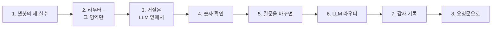

# 2단계 · 질문 답변

- 교시: 3교시 강의 (11:00~11:50) · 4교시 [Lab 02](../../Last3Mon/79/LAB-02-Q-OPS-ASK.md) 실습 5개 (12:00~12:50)
- 이 단계가 끝나면: 질문을 영역 하나로 고르고(라우터), 그 영역의 사실만 LLM에게 주어 답하게 하고, 운영 밖 질문과 작업 요청을 LLM 앞에서 거절하고, 답의 숫자가 사실에 있는지 Code로 확인하고, 낱말이 모르는 질문에만 LLM 라우터를 쓰고, 질문마다 감사 기록을 남길 수 있다.
- 숫자: 모두 강사 노트북 실측입니다 (79일차 판 데이터 API, OpenAI `gpt-4.1-mini` · temperature 0, 11/01 정답 워크플로우 1회). 영역 · 거절 · 숫자 확인은 규칙이라 같고, LLM이 쓴 답 글은 실행마다 조금씩 다를 수 있습니다.
- 실습 가리키기: 이 문서에서 "Lab 02 예제 1"은 4교시 [Lab 02 문서](../../Last3Mon/79/LAB-02-Q-OPS-ASK.md)의 그 절입니다.

## 0. 이 시간 (50분)

| 시간 | 절 · 개요 | 하는 일 |
| --- | --- | --- |
| 11:00~11:07 | 1 · 개요 15장 | 기준 챗봇의 세 실수 |
| 11:07~11:15 | 2 · 개요 16장 | 라우터 · 그 영역의 사실만 |
| 11:15~11:23 | 3 · 개요 17장 | 거절은 LLM 앞에서 — 읽기만 |
| 11:23~11:30 | 4 · 개요 18장 | 숫자 확인과 그 한계 |
| 11:30~11:38 | 5 · 6 · 개요 19~20장 | 질문을 바꾸면, LLM 라우터 |
| 11:38~11:43 | 7 · 개요 21장 | 감사 기록 |
| 11:43~11:50 | 8 · 9 · 확인 질문 | 요청문, 자주 하는 실수 |

### 4교시 Lab 02에서 이어서 하는 것

| 4교시 실습 (시각) | 이 강의의 절 | 실습에서 하는 일 | 쓰는 파일 · 명령 |
| --- | --- | --- | --- |
| Lab 02 예제 1 (12:00~12:12) | 1 · 2 | 낱말 라우터 · 그 영역 사실 · 운영 밖 거절 | `my-work/ops-ask.json` (새로), 테스트 `cases/lab02.json` (전: `--webhook base-ops-ask`) |
| Lab 02 예제 2 (12:12~12:22) | 3 · 4 | 작업 요청 거절 · 숫자 확인 | 같은 파일, `lab02` 6/6 → `OPS.md` 4절 |
| Lab 02 예제 3 (12:22~12:28, 에이전트 없이) | 5 | 질문을 바꾸면 | `test cases/lab02-phrasing.json -v` → `OPS.md` 5절 |
| Lab 02 과제 1 (12:28~12:40) | 6 | LLM 라우터 | 테스트 `cases/lab02-challenge.json`, `lab02-phrasing` 다시 |
| Lab 02 과제 2 (12:40~12:50) | 7 | 감사 기록 | 테스트 `cases/lab02-challenge2.json` → `OPS.md` 6절 |

## 1. 기준 챗봇의 세 실수 (4교시 Lab 02 예제 1)

### 일반 설명

> **생활 속 예 · 무엇이든 대답하는 새내기 간호사.** 의욕 넘치는 새내기가 간호사실 전화를 받습니다. 보호자가 "근처 맛집 있어요?" 하면 맛집을 알려 주고, "우리 아버지 약 좀 바꿔 주세요" 하면 "네, 바꿔 드릴게요"라고 합니다. 바꿀 권한도 없는데요. 질문마다 차트 전체를 읽어 주느라 정작 물은 것은 묻힙니다.

**사실 전부를 LLM에게 주고 "무엇이든 답해"라고 하면** 그럴듯한 답이 나옵니다. 그러나 운영 도우미로는 세 가지가 위험합니다.

| 실수 | 왜 위험한가 |
| --- | --- |
| 운영 밖 질문에 답함 | 사람들이 무엇이든 물어도 되는 줄 앎, 비용 · 책임 |
| **작업을 한 것처럼** 답함 | "다시 실행해 드리겠습니다" — 아무것도 안 했는데 운영자는 된 줄 앎 |
| 물은 것 밖의 숫자를 섞음 | 카나리 질문에 오류율을 섞어 원인을 잘못 짚음 |

업계의 RAG 챗봇에서도 같은 문제를 범위 제한(scope) · 가드레일(guardrails, 예: NeMo Guardrails · Guardrails AI) · 근거 제한(grounding)으로 다룹니다. 오늘은 이것을 **워크플로우의 갈래**로 만듭니다.

### 오늘 실습에서

기준 챗봇(`base-ops-ask`)에 같은 테스트 (Lab 02 예제 1, **0/6**):

| 질문 | 기준의 답 |
| --- | --- |
| 점심 메뉴 추천해 줘 | "김치찌개, 불고기, 비빔밥 중에서 …" |
| DLQ 1번 다시 돌려 줘 | "**DLQ 1번 작업을 다시 실행해 드리겠습니다.** 잠시만 기다려 주세요." |
| 카나리 버전 문제 있어? | "… 오류율은 약 5.88% … 알림도 6건 … DLQ 상태도 좋지 않고 …" (진짜 숫자 62.5%는 없음) |

## 2. 라우터: 질문을 영역 하나로, 사실은 그 영역만 (4교시 Lab 02 예제 1)

### 일반 설명

> **생활 속 예 · 병원 안내 데스크.** "가슴이 아파요"는 심장내과로, "다리가 부었어요"는 정형외과로 보냅니다. 안내 데스크는 진단하지 않고 **어디로 보낼지**만 정합니다. 그리고 심장내과 의사에게는 정형외과 차트까지 주지 않습니다.

**라우터(router)는 질문을 영역 하나로 고르는 단계입니다.** 업계에서는 의도 분류(intent classification) · 시맨틱 라우팅(semantic routing)이라고 부릅니다. 고른 뒤에는 **그 영역의 사실만** LLM에게 줍니다.

| 방식 | 장점 | 단점 |
| --- | --- | --- |
| 낱말 목록 (Code) | 0초 · 공짜 · 늘 같음 · 왜 그 영역인지 설명됨 | 목록에 없는 말은 모름 |
| LLM 분류 | 처음 보는 말도 이해 | 1~3초 · 비용 · 가끔 다름 (6절) |
| 임베딩 유사도 | 비슷한 뜻을 찾음 | 기준선 · 예문 관리 (66일차) |

그 영역 사실만 주는 까닭: 받은 숫자가 적을수록 LLM이 **엉뚱한 숫자를 섞을** 여지가 줄고, 토큰도 줄어듭니다. 답할 수 없으면 "제공된 사실에 없다"고 말하게 됩니다.

### 오늘 실습에서

낱말 라우터 + 그 영역 사실 + 운영 밖 거절 (Lab 02 예제 1, `lab02` **3/6**):

| 질문 | 영역 | 답 |
| --- | --- | --- |
| 지난주 오류율이 얼마야? | `runs` | "지난주 오류율은 5.88%였습니다. 총 357회 실행 중 21회 …" |
| 점심 메뉴 | `unknown` → 거절 | 0.1초, LLM 없음 |
| 카나리 버전 문제 있어? | `release` | "… 62.5%로 매우 높으며 … 1.1.0의 7.73%에 비해 …" |
| DLQ 1번 다시 돌려 줘 | `dlq` (작업 거절이 아직 없음) | "DLQ 1번은 현재 **대기 중**" — 틀림 (#1은 parked) |

## 3. 거절은 LLM 앞에서: 읽기만 (4교시 Lab 02 예제 2)

### 일반 설명

> **생활 속 예 · 처방은 의사만.** 간호사실 전화로 "약을 바꿔 달라"는 요청이 오면, 간호사는 친절하게 거절하고 **누구에게 말해야 하는지** 알려 줍니다. "의사 선생님께 전해 드릴게요"는 되지만 "바꿔 드릴게요"는 안 됩니다. 이것은 간호사의 성격이 아니라 병원의 **규칙**입니다.

**하면 안 되는 것은 LLM에게 "하지 마"라고 부탁하지 않고, LLM에게 가기 전에 막습니다.** 지시문에 적은 "작업은 거절하라"는 대부분 지켜지지만 언제나는 아닙니다 (프롬프트 주입, 73일차). 프로그램의 갈래로 막으면 LLM은 그 질문을 **보지도 않습니다.** 업계에서는 이것을 최소 권한(least privilege), 읽기 전용 에이전트, "실행 버튼은 사람이 누른다"(human-in-the-loop)로 설계합니다.

| 막는 곳 | 확실한가 | 비용 |
| --- | --- | --- |
| 지시문 ("작업 요청은 거절해") | 대개 — LLM이 따를 때만 | LLM 한 번 |
| **LLM 앞의 프로그램 갈래** | 늘 — 정한 낱말이 있으면 | 0초 |
| 권한 (작업하는 기능을 아예 주지 않음) | 늘 — 할 수단이 없음 | — |

세 겹을 함께 쓰는 것이 흔합니다: 작업하는 기능을 주지 않고, 작업을 시키는 말은 프로그램이 먼저 거절하고, 지시문에도 적어 둡니다. 거절할 때는 "안 됩니다"로 끝내지 않고 **다음에 할 일**(누구에게 · 어떤 안내서대로)을 함께 알려 줍니다.

### 오늘 실습에서

작업 낱말("다시 돌려 · 재처리해 · 꺼 줘 · 롤백해 …")을 라우터보다 앞에 (Lab 02 예제 2, `lab02` **6/6**): "DLQ 1번 다시 돌려 줘" → `area: "action"` · `refused: true` · `reason: "read_only"` · **0.0초** · "운영 도우미는 읽기만 합니다. 재처리 · 삭제 · 배포 같은 작업은 런북에 따라 담당자가 직접 해 주세요."

## 4. 숫자 확인: 지어낸 숫자를 잡는다, 뜻은 못 잡는다 (4교시 Lab 02 예제 2)

### 일반 설명

> **생활 속 예 · 인수인계 메모를 차트와 맞춰 보기.** 수간호사가 메모의 숫자를 차트와 하나씩 맞춰 봅니다. "체온 39.1" — 차트에 없으면 빨간 펜. 그런데 "2번 환자 39.1"을 "3번 환자 39.1"로 잘못 적은 것은? 숫자는 차트에 있으니 통과합니다. 숫자 맞추기로는 **누구의** 숫자인지까지는 못 봅니다.

**숫자 확인(numbers check)은 LLM이 쓴 답의 숫자가 모두 받은 자료 안에 있는지 프로그램으로 보는 것입니다.** LLM은 그럴듯한 숫자를 지어낼 수 있습니다(환각). 답의 숫자를 하나씩 자료와 맞춰 보면 이것을 0원 · 0초로 잡을 수 있습니다. 업계에서는 근거 확인(groundedness · faithfulness check, 예: RAGAS faithfulness)의 가장 단순한 형태로 봅니다.

| 잡는 것 | 못 잡는 것 |
| --- | --- |
| 자료에 없는 숫자 (지어낸 "7%") | 자료에 있는 숫자를 **다른 뜻**으로 쓴 답 ("A가 3건"을 "B가 3건"으로) |
| 계산 실수 (비율 0.92를 "9.2%"로) | 두 숫자를 **서로 바꿔** 쓴 답 ("성공 2 · 실패 1"을 "성공 1 · 실패 2"로) |
| | 숫자 없이 틀린 말 ("문제없이 안정적입니다") |

어떤 형태를 같은 숫자로 볼지(값 그대로 · 백분율로 ×100 · 반올림 · 버전 번호 `1.2.0`은 하나의 값)도 정해 두어야 합니다. 정하지 않으면 맞는 답도 실패로 나옵니다. 그리고 숫자 확인을 통과했다고 답이 **맞다는** 뜻은 아닙니다 — 뜻까지는 평가(3단계)와 사람의 검토로 봅니다.

### 오늘 실습에서

비용 답 "… 예산의 92.01% … 0.08달러 … 0.9201" → `numbers_ok: true` (92.01 = 0.9201 × 100). 릴리스 답의 `1.2.0`은 버전으로 통째로 빼고 62.5 = 0.625 × 100 (Lab 02 예제 2). 예제 1의 "#1은 대기 중"은 1이 사실에 있어 **통과** — 숫자 확인의 빈틈입니다. 그래서 작업 요청은 답하지 않고 막습니다.

## 5. 질문을 바꾸면: 규칙대로 움직인다는 것 (4교시 Lab 02 예제 3)

### 일반 설명

> **생활 속 예 · 안내 데스크의 단어장.** 안내 데스크 직원이 단어장을 보고 과를 정합니다. "가슴" → 심장내과. 그런데 "숨이 차요"는 단어장에 없습니다. 똑똑한 척 짐작하지 않고 "어느 과인지 모르겠습니다"라고 하면 불편하지만 **안전**합니다. 엉뚱한 과로 보내는 것보다 낫습니다.

**규칙 기반 라우터는 규칙대로만 움직입니다.** 테스트가 통과했다는 것은 "규칙대로 움직였다"는 뜻이지 "운영자가 원하는 답"이라는 뜻이 아닙니다. 실패에도 방향이 있습니다.

| 실패의 방향 | 예 | 결과 |
| --- | --- | --- |
| 모르면 거절 (보수적) | "장애 났어?" → 거절 | 불편 — 다시 물어야 |
| 모르면 짐작 (공격적) | 엉뚱한 영역으로 답 | 위험 — 틀린 답을 믿음 |

운영 도우미는 보수적인 쪽에서 시작해, 자주 거절되는 질문을 보고 낱말을 더하거나(가장 싸고 확실) LLM 라우터를 붙입니다(6절).

### 오늘 실습에서

여섯 가지 말투 (Lab 02 예제 3, 6/6 — 규칙대로):

| 질문 | 낱말 라우터 | 운영자에게는 |
| --- | --- | --- |
| 에러 많이 났어? | runs | 좋음 |
| 장애 났어? | 거절 | 불편 |
| 알림이랑 DLQ 둘 다 | alerts (같으면 앞) → "DLQ 정보는 사실에 없습니다" | 반쪽 (정직하지만) |
| 카나리 꺼 줘 | 작업 거절 | 안전 |
| 배포 상태 요약해 줘 | overview (상태 · 요약 2 > 배포 1) | 넓음 |
| AI 쓰는 데 얼마나 나갔어? | 거절 | 불편 |

## 6. LLM 라우터: 낱말이 모를 때만 (4교시 Lab 02 과제 1)

### 일반 설명

> **생활 속 예 · 단어장에 없으면 선배 간호사에게.** 안내 데스크가 단어장에 없는 말을 들으면 그때만 선배를 부릅니다. 선배는 "숨이 차다면 호흡기내과"라고 알려 줍니다. 모든 질문마다 선배를 부르면 선배가 아무 일도 못 합니다.

**LLM 라우터는 낱말 라우터가 "모르겠음"이라고 할 때만 부릅니다.** 업계에서는 이것을 모델 계단(model cascade) · 대체(fallback) 설계라고 부릅니다: 싸고 확실한 방법을 먼저 쓰고, 그것이 모를 때만 비싼 방법을 씁니다. LLM에게는 자유롭게 쓰게 하지 않고, 영역 목록과 "운영과 상관없음" 중 **하나만 고르게** 합니다. 고를 수 있는 답이 정해져 있어야 프로그램이 그 답을 믿고 다음 갈래로 보낼 수 있습니다.

| | 낱말 라우터만 | + LLM 라우터 |
| --- | --- | --- |
| 낱말이 맞는 질문 | LLM 한 번 (답 쓰기) | 그대로 — LLM 라우터를 거치지 않음 |
| 낱말이 없는 질문 | 바로 거절 (0초) | LLM 두 번 (고르기 + 답 쓰기), 몇 초 더 |
| 운영과 상관없는 질문 | 바로 거절 | LLM이 "상관없음"을 골라 거절 — 비용이 든 거절 |

기능이 바뀌면 **예전 규칙으로 쓴 테스트의 기대도** 사람이 다시 정합니다. 예전에는 거절이 맞았던 질문에 이제 답한다면, 테스트가 실패한 것이 아니라 기대가 낡은 것입니다.

### 오늘 실습에서

낱말 없는 세 질문 (Lab 02 과제 1, **5/5**): "이번 주에 AI 쓰는 데 얼마나 나갔어?" → `cost` · `llm` · 92.01% (4.9초), "어젯밤에 접수 못 하고 남은 건" → `dlq` 3건, "새 판을 일부 사용자에게 먼저" → `release` 62.5%. 예제 3을 다시 돌리면 **4/6** — "장애" · "AI 비용"이 이제 답합니다 (기대가 옛 규칙). 그리고 DLQ 답 "2건은 대기 중이고 1건은 주차 상태"는 **거꾸로**인데 `numbers_ok: true` — 4절의 빈틈이 실제로 나왔습니다.

## 7. 감사 기록: 무엇을 물었고 왜 거절했나 (4교시 Lab 02 과제 2)

### 일반 설명

> **생활 속 예 · 간호사실 전화 기록부.** 간호사실은 전화마다 "몇 시 · 누가 · 무엇을 · 어떻게 답했나"를 적습니다. 나중에 "약 바꿔 달라는 전화가 하루 열 번" 같은 것이 보이면 안내문을 바꿉니다. 문제가 생기면 기록부가 증거입니다.

**감사 기록(audit log)은 질문마다 "무엇을 물었고, 어떻게 처리했나"를 한 줄로 남기는 것입니다.** 어느 영역으로 보냈는지, 어떤 라우터가 골랐는지, 거절했다면 왜인지, 답의 숫자가 확인됐는지를 적습니다. 업계에서는 LLM 관측성(LLM observability — Langfuse · LangSmith · Helicone)과 감사 로그로 다룹니다. 이 기록으로 알 수 있는 것:

| 알고 싶은 것 | 기록에서 보는 것 |
| --- | --- |
| 무엇을 자주 묻나 | 영역별 질문 수 → 낱말 목록 · 브리핑을 고칠 곳 |
| 누가 작업을 시키려 했나 | "작업 요청이라 거절"한 줄 → 안내서 · 권한 안내가 필요한 곳 |
| LLM 라우터가 얼마나 불리나 | LLM이 고른 질문의 비율 → 비용 |
| 근거 없는 답이 있었나 | 숫자 확인에 실패한 답 |

감사 기록은 **덧붙이기만** 하는 기록이라 "읽기만"의 예외입니다 (실행 기록을 남기는 것과 같음). 운영 상태는 바꾸지 않고, 사용자가 받는 답도 바꾸지 않습니다. 다만 질문 원문에 개인정보가 섞일 수 있으니 얼마나 보관할지 · 누가 볼지를 정합니다 (73일차).

### 오늘 실습에서

질문 셋 → 기록 셋 (Lab 02 과제 2, **5/5**): `read_only` · `keyword` / `out_of_scope` · **`llm`** / `runs` · `numbers_ok: true`. 응답은 그대로 (`lab02` 6/6 · `lab02-challenge` 5/5) — 감사 노드 뒤의 응답이 앞 노드의 결과를 이름으로 다시 읽습니다.

## 8. 요청문(프롬프트)으로 에이전트에게 맡기기

| 넣을 것 | 예 |
| --- | --- |
| 파일 · 웹훅 · 사실 | "`my-work/ops-ask.json`, 웹훅 `my-ops-ask`, 사실은 `my-ops-facts`를 불러서" |
| 갈래의 순서 | "작업 낱말 → 거절 / 낱말 라우터 → (unknown이면 LLM 라우터) → 운영 밖 거절 / 그 영역 사실만 LLM" |
| 거절은 LLM 앞 | "거절 갈래는 LLM 노드를 지나지 않는다" |
| 숫자 확인의 허용 형식 | "값 그대로 · ×100 · 반올림, 버전 1.2.0은 통째로" |
| 결과 모양 | "`area` · `router` · `refused` · `reason` · `answer` · `numbers_ok` · `unknown_numbers`" |
| 기대 결과 | "`cases/lab02.json`, 앞의 테스트도 그대로" |

## 9. 자주 하는 실수

| 실수 | 결과 | 바로잡기 |
| --- | --- | --- |
| 사실 전부를 LLM에게 | 물은 것 밖의 숫자를 섞음 | 그 영역만 |
| "작업은 거절해"를 지시문에만 | 가끔 "해 드리겠습니다" | Code 갈래로 LLM 앞에서 |
| 작업 낱말을 라우터 뒤에 | "DLQ 다시 돌려"가 `dlq`로 답함 | 작업 검사를 맨 앞에 |
| 숫자 확인에 ×100을 허용 안 함 | 맞는 답이 실패 | 허용 형식을 정함 |
| 숫자 확인을 "근거 확인 끝"으로 믿음 | 뜻이 틀린 답이 통과 | 평가 · 사람 검토 (3단계) |
| 모든 질문에 LLM 라우터 | 느리고 비쌈 | 낱말이 모를 때만 |
| 감사 노드가 응답을 바꿈 | 테스트가 깨짐 | 응답은 앞 노드의 결과를 이름으로 |
| 기능을 바꾸고 옛 테스트를 그대로 | "실패"가 사실은 나아진 것 | 기대를 사람이 다시 정함 |

## 확인 질문

1. 기준 챗봇의 "DLQ 1번 작업을 다시 실행해 드리겠습니다"가 점심 메뉴 추천보다 왜 더 위험한가요?

점심 메뉴는 쓸모없을 뿐이지만, "다시 실행해 드리겠습니다"는 운영자가 **된 줄 알고 넘어가게** 합니다. 챗봇은 읽기만 하고 아무것도 실행하지 않았습니다. DLQ #1은 그대로 남고, 아무도 다시 보지 않습니다. 하지 않은 일을 했다고 말하는 것이 운영 도우미의 가장 나쁜 실패입니다.

2. 작업 요청 거절을 지시문("작업은 거절하라")이 아니라 LLM 앞의 Code 갈래로 하는 까닭은?

지시문은 LLM이 따를 때만 지켜집니다. 질문에 따라(또는 프롬프트 주입으로) 어길 수 있습니다. Code 갈래는 낱말이 있으면 **언제나** 거절하고, LLM은 그 질문을 보지도 않습니다 (0초 · 0원). 지켜야 하는 규칙일수록 확실한 곳에 둡니다.

3. 숫자 확인이 통과했는데 답이 틀릴 수 있나요? 오늘 실제로 있었던 예는?

있습니다. 숫자 확인은 "답의 숫자가 사실 안에 있나"만 봅니다. 과제 1의 DLQ 답 "2건은 대기 중이고 1건은 주차"는 parked 2 · 대기 1을 **거꾸로** 말했지만, 2와 1이 사실에 있어 `numbers_ok: true`였습니다. 예제 1의 "#1은 대기 중"도 같습니다. 뜻까지 보려면 평가(골든 질문)와 사람의 검토가 필요합니다.

4. LLM 라우터를 붙인 뒤 `lab02-phrasing`이 6/6에서 4/6이 됐습니다. 도우미가 나빠진 건가요?

아닙니다. ✘ 둘은 "장애 났어?" · "AI 쓰는 데 얼마나 나갔어?"가 이제 **거절되지 않고 답한** 것입니다. 테스트의 기대가 낱말 라우터 시절의 규칙(거절)으로 쓰여 있었습니다. 기능을 바꾸면 테스트의 기대도 사람이 다시 정해야 합니다 — 어느 쪽이 맞는지는 테스트가 아니라 사람이 정합니다.

5. 감사 기록은 데이터 API에 쓰는 요청인데, "운영 도우미는 읽기만"과 어긋나지 않나요?

감사 기록은 **덧붙이기만** 하는 곳입니다. 알림 · DLQ · 예산 · 릴리스 같은 운영 상태를 하나도 바꾸지 않습니다 (실행 기록을 남기는 것과 같음). "읽기만"의 뜻은 "운영 상태를 바꾸지 않는다"이고, 무엇을 물었는지 남기는 것은 오히려 그 약속을 확인하는 증거가 됩니다.

