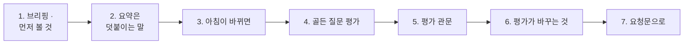

# 3단계 · 브리핑과 평가

- 교시: 5교시 강의 (14:00~14:50) · 6교시 [Lab 03](../../Last3Mon/79/LAB-03-Q-OPS-BRIEF.md) 실습 5개 (15:00~15:50)
- 이 단계가 끝나면: 사실 · 상태로 "먼저 볼 것"과 정해진 할 일을 규칙으로 정한 브리핑을 만들고, LLM 요약을 덧붙이는 말로만 쓰고, 사람이 일을 하면 브리핑이 어떻게 바뀌는지 읽고, 골든 질문으로 도우미를 평가하고, 평가 점수로 관문을 세워 떨어지면 알릴 수 있다.
- 숫자: 모두 강사 노트북 실측입니다 (79일차 판 데이터 API, OpenAI `gpt-4.1-mini` · temperature 0, 11/01 정답 워크플로우 1회). 브리핑의 표 · 순서는 Code라 같고, 요약 글과 시간은 실행마다 다를 수 있습니다.
- 실습 가리키기: 이 문서에서 "Lab 03 예제 1"은 6교시 [Lab 03 문서](../../Last3Mon/79/LAB-03-Q-OPS-BRIEF.md)의 그 절입니다.

## 0. 이 시간 (50분)

| 시간 | 절 · 개요 | 하는 일 |
| --- | --- | --- |
| 14:00~14:09 | 1 · 개요 22장 | 브리핑 — 먼저 볼 것은 규칙으로 |
| 14:09~14:16 | 2 · 개요 23장 | LLM 요약은 덧붙이는 말 |
| 14:16~14:23 | 3 · 개요 24장 | 아침이 바뀌면 — 초록이 된 까닭 |
| 14:23~14:33 | 4 · 개요 25~26장 | 골든 질문 평가 |
| 14:33~14:43 | 5 · 6 · 개요 27~28장 | 평가 관문, 평가가 바꾸는 것 |
| 14:43~14:50 | 7 · 8 · 확인 질문 | 요청문, 자주 하는 실수 |

### 6교시 Lab 03에서 이어서 하는 것

| 6교시 실습 (시각) | 이 강의의 절 | 실습에서 하는 일 | 쓰는 파일 · 명령 |
| --- | --- | --- | --- |
| Lab 03 예제 1 (15:00~15:12) | 1 | 아침 브리핑 | `my-work/ops-brief.json` (새로), 테스트 `cases/lab03.json` |
| Lab 03 예제 2 (15:12~15:20) | 2 | LLM 요약 · 숫자 확인 | 같은 파일, 테스트 `cases/lab03-llm.json` → `OPS.md` 7절 |
| Lab 03 예제 3 (15:20~15:26, 에이전트 없이) | 3 | 아침이 바뀌면 | `test cases/lab03-after.json -v` → `OPS.md` 8절, `morning --reset` |
| Lab 03 과제 1 (15:26~15:40) | 4 | 골든 질문 평가 | `my-work/ops-eval.json` (새로), 테스트 `cases/lab03-challenge.json` |
| Lab 03 과제 2 (15:40~15:50) | 5 · 6 | 평가 관문 | 테스트 `cases/lab03-challenge2.json` → `OPS.md` 9절, `morning --reset` |

## 1. 브리핑: 먼저 볼 것은 규칙으로 (6교시 Lab 03 예제 1)

### 일반 설명

> **생활 속 예 · 인수인계는 빨강 환자부터.** 낮 근무가 인수인계를 받을 때, 밤 근무는 병실 번호 순서가 아니라 **급한 순서**로 말합니다. 빨강 자석 환자 먼저, 그다음 노랑. 그리고 환자마다 "다음에 할 일"이 정해져 있습니다 — "고열이면 해열제 · 1시간 뒤 다시 체온". 말하는 사람이 바뀌어도 순서와 할 일이 같습니다.

**브리핑은 숫자와 상태를 "먼저 볼 것"과 "할 일"로 바꾼 한 장입니다.** 업계에서는 당번 인수인계 문서(on-call handoff), 장애 대응 안내서(runbook), 아침 스탠드업 리포트라고 부릅니다. 브리핑의 세 부분은 모두 규칙으로 정할 수 있습니다.

| 부분 | 무엇을 보고 만드나 | 규칙 |
| --- | --- | --- |
| 전체 상태 · 영역 표 | 이미 매긴 색과 숫자 | 다시 판정하지 않고 그대로 옮김 |
| 먼저 볼 것 | 빨강 영역, 그다음 노랑 영역 | 정해진 영역 순서로 앞의 몇 개 |
| 할 일 | 영역마다 미리 적어 둔 한 줄 | 안내서(runbook)의 문장 그대로 |

먼저 볼 것을 LLM에게 고르게 하면 같은 아침에 다른 순서가 나옵니다. 할 일을 LLM에게 쓰게 하면 안내서에 없는 일("서버를 재시작하세요")을 권할 수 있습니다. 순서와 할 일처럼 **정답이 정해진 것은 프로그램이**, 사람이 읽기 좋은 요약만 LLM이 합니다 (다음 절).

### 오늘 실습에서

`my-ops-brief` (Lab 03 예제 1, **4/4**, LLM 없음):

| 영역 | 상태 | 숫자 |
| --- | --- | --- |
| 실행 | 🔴 | 오류율 5.88% · p95 2598ms · 답 못 함 4.76% |
| DLQ | 🔴 | 3건 (parked 2) |
| 릴리스 | 🔴 | 1.1.0 · 카나리 1.2.0 20% (다시 묻기 62.5%) |
| 알림 · 품질 · 비용 | 🟡 | 6건 (높음 3) · 평균 0.6583 · 마지막 1 · 격리 1 · $0.073604 / $0.08 (92.01%) |

- 먼저 볼 것: ① 🔴 실행 "오류 묶음 1위 확인 · 고치기 (77일차)" ② 🔴 DLQ "parked 건 원인 확인 뒤 런북대로 재처리 (76일차)" ③ 🔴 릴리스 "카나리 끄기 · 되돌리기 검토 (74일차)". DLQ를 비우면 셋째 자리에 알림.

## 2. LLM 요약은 덧붙이는 말 (6교시 Lab 03 예제 2)

### 일반 설명

> **생활 속 예 · 인수인계 끝의 한마디.** 표와 할 일 목록을 다 넘긴 뒤, 밤 근무가 한마디 덧붙입니다. "오늘은 3호실이 제일 걱정이에요." 사람에게는 이 한마디가 기억에 남습니다. 그러나 이 한마디가 표를 **대신**하면 안 됩니다 — 한마디에는 다른 두 환자가 빠졌으니까요.

**LLM 요약은 브리핑에 덧붙이는 사람의 말입니다.** 사람은 표보다 문장을 빨리 읽습니다. 그래서 세 문장 요약을 붙이되, 둘을 지킵니다.

| 원칙 | 까닭 |
| --- | --- |
| 표 · 먼저 볼 것 · 할 일은 Code가 만든 그대로 | 요약은 길이 때문에 일부만 말함 |
| 요약에도 숫자 확인 (2단계) | 지어낸 숫자를 회의에 가져가지 않게 |

업계의 "AI 요약" 기능(인시던트 요약 · 회의 요약)도 원문 링크 · 원 데이터를 함께 두는 까닭이 같습니다.

### 오늘 실습에서

두 번 부른 요약 (Lab 03 예제 2, **2/2**, `numbers_ok: true` 둘 다):

- "전체 시스템 상태는 빨간색으로, 오류율은 5.88%이며 DLQ 크기는 3입니다. 가장 긴급한 문제는 'Search FAQ' 노드에서 발생하는 1000ms 타임아웃 오류로 16건이 보고되었습니다. …"
- "전체 시스템 상태는 빨간색으로, 오류율은 5.88%이며, 응답하지 않은 비율은 4.76%입니다. 가장 긴급한 문제는 'Search FAQ' 노드에서 발생한 16건의 타임아웃 오류입니다. …"
- 둘 다 먼저 볼 것 셋 중 **하나**(실행)만 말했습니다. DLQ parked · 카나리는 세 문장에 없습니다.

## 3. 아침이 바뀌면: 초록이 된 까닭을 함께 말한다 (6교시 Lab 03 예제 3)

### 일반 설명

> **생활 속 예 · 빨강 자석을 뗀 까닭.** 오후에 빨강 자석이 셋 다 떨어졌습니다. 하나는 열이 내려서, 하나는 다른 병동으로 옮겨서, 하나는 "38.5도 기준을 39도로 바꿔서"입니다. 셋 다 "빨강 아님"이지만 뜻이 전혀 다릅니다. 셋째를 "나았다"고 보고하면 큰일입니다.

**브리핑은 사실이 바뀌면 다시 만들어지는 할 일 목록입니다.** 브리핑을 고치지 않아도, 사람이 일을 하면 표 · 순서 · 할 일이 따라 바뀝니다. 그런데 색이 바뀐 **까닭**은 여러 가지입니다.

| 까닭 | 예 | 뜻 |
| --- | --- | --- |
| 일을 끝냄 | 사람이 볼 일로 남아 있던 건을 처리 | 고쳤다 |
| 위험을 멈춤 | 문제가 있는 새 판을 끔 | 원인은 그대로 |
| 기준 · 한도를 바꿈 | 예산 올림 | 쓴 돈은 그대로 |

77일차 SLO에서 "기준을 바꾸면 초록이 된다"를 본 것과 같습니다. 회의에서 "초록입니다"만 말하지 않고 **무엇을 했는지**를 함께 말합니다.

### 오늘 실습에서

케이스가 이어서 가는 테스트 (Lab 03 예제 3, 5/5):

| 사람이 한 일 | 빨강 | 먼저 볼 것 |
| --- | --- | --- |
| (아침 그대로) | runs · dlq · release | 실행 · DLQ · 릴리스 |
| parked 둘 처리 | runs · release | 실행 · 릴리스 · 알림 |
| 카나리 끔 | runs | 실행 · 알림 · DLQ |
| 예산 0.08 → 0.2 | runs (비용 0.9201 → 0.368, 🟢) | 실행 · 알림 · DLQ |

- 남은 빨강(FAQ timeout)은 아무도 고치지 않았습니다 — 77일차 Lab 03의 일입니다.

## 4. 골든 질문 평가: 도우미를 시험한다 (6교시 Lab 03 과제 1)

### 일반 설명

> **생활 속 예 · 새 간호사의 모의 인수인계 시험.** 새 간호사가 병동에 투입되기 전, 수간호사가 정해진 질문 여덟 개로 시험합니다. "3호실 체온은?" "약을 바꿔 달라는 전화가 오면?" 답이 정해져 있어 누가 채점해도 같습니다. 교육 내용이 바뀔 때마다 같은 시험을 다시 봅니다.

**평가(evaluation)는 답을 미리 알고 있는 질문으로 도우미를 시험하는 것입니다.** 이 질문 묶음을 골든 세트(golden set) · 평가 데이터셋이라고 부르고, 업계에서는 LLM 평가 도구(OpenAI Evals · promptfoo · RAGAS · DeepEval · LangSmith)로 돌립니다. 질문마다 무엇을 확인할지 미리 정합니다.

| 확인할 것 | 묻는 것 |
| --- | --- |
| 영역 | 맞는 영역으로 보냈나 |
| 거절 | 거절해야 할 질문(작업 · 운영 밖)을 거절했나 |
| 기대 숫자 | 꼭 나와야 할 숫자가 답에 있나 |
| 근거 | 답의 숫자가 모두 자료에 있나 (숫자 확인) |

점수는 "모두 맞은 질문 수 ÷ 전체 질문 수"입니다. 평가는 질문마다 LLM을 부르므로 도우미 한 번보다 느리고 비쌉니다 — 도우미를 고칠 때마다 돌리되, 운영 중 질문마다 돌리지는 않습니다. 그리고 질문이 하나도 없으면 오류로 돌려보냅니다: "0개 중 0개 맞음 = 100점"으로 속지 않게.

### 오늘 실습에서

`my-ops-eval`에 골든 질문 8개 (Lab 03 과제 1, **3/3**): **8/8 · score 1** (3.9초). 기대를 일부러 틀리게 쓴 질문("알림이 몇 건?"의 영역을 `cost`로) → `area_ok: false`만 틀림 — 도우미는 맞았고 **시험지가** 틀렸다는 것을 평가가 보여 줍니다. 그러나 8/8이어도 2단계의 "parked 2 · 대기 1을 거꾸로" 같은 답은 통과합니다 — 골든 질문에 틀리기 쉬운 것을 더해 갑니다.

## 5. 평가 관문: 점수가 떨어지면 멈추고 알린다 (6교시 Lab 03 과제 2)

### 일반 설명

> **생활 속 예 · 합격선 80점.** 모의 시험에 합격선이 없으면 50점을 받아도 병동에 나갑니다. 합격선을 정해 두면 "80점 아래면 다시 교육"이 자동으로 정해집니다. 그리고 떨어진 사람이 있으면 수간호사에게 알림이 갑니다.

**평가 관문(eval gate)은 평가 점수를 기준과 비교해 통과 · 실패를 정하는 것입니다.** 74일차 배포 관문 · 78일차 품질 관문과 같은 모양입니다. 업계에서는 프롬프트나 모델을 바꿀 때마다 CI(자동 시험)에서 평가를 돌리고, 점수가 떨어지면 배포를 막습니다 (LLMOps의 회귀 시험).

| 정할 것 | 흔한 방법 |
| --- | --- |
| 기준 점수 | 입력으로 받고, 없으면 기본값 (예: 0.9) |
| 통과 · 실패 | 점수 ≥ 기준이면 통과, 아니면 실패 |
| 실패하면 | 알림을 남겨 사람이 알게 함 — 운영 브리핑에도 보임 |

기준을 코드에 박지 않고 입력으로 받는 까닭은 78일차 기준과 같습니다: 기준은 팀이 고르는 값이고, 바꿀 때마다 프로그램을 고치지 않게.

### 오늘 실습에서

(Lab 03 과제 2, **4/4**): 알림 질문 하나 · 기준 없음 → 0.9 · pass, 골든 8 · 0.8 → pass, 틀린 기대 · 0.9 → **fail** → 알림 `{"workflow": "ops-eval", "reason": "eval_below", "score": 0, "min_score": 0.9}`.

## 6. 평가가 바꾸는 것: 시험이 시험을 바꾼다 (6교시 Lab 03 과제 2)

### 일반 설명

> **생활 속 예 · 모의 시험 중에 울린 호출벨.** 모의 시험 문제 "지금 호출벨이 몇 개 울렸나?"를 내기 직전에, 앞 문제를 채점하던 수간호사가 호출벨을 하나 눌렀습니다. 새 간호사는 정확히 "7개"라고 답했는데, 정답지는 "6개". 새 간호사가 틀린 것이 아닙니다 — 시험이 병동을 바꿨습니다.

**평가가 남기는 흔적(알림 · 기록 · 사용량)이 다음 평가의 답을 바꿀 수 있습니다.** 운영 데이터를 읽는 도우미를 평가할 때 특히 그렇습니다. 앞 시험이 알림을 하나 남기면, 다음 질문 "알림이 몇 건이야?"의 맞는 답이 바뀝니다. 업계에서는 이것을 시험 격리(test isolation), 고정된 처음 상태(fixture)로 다룹니다.

| 지키는 것 | 하는 일 |
| --- | --- |
| 처음 상태에서 | 평가 전에 운영 데이터를 정해진 처음 상태로 되돌림 |
| 순서를 생각 | 상태를 바꾸는 시험(실패 → 알림)은 그 상태를 읽는 시험 **뒤에** |
| 평가 자신의 흔적 | 기록에 평가 질문이 섞이므로, 평가가 남긴 것인지 표시해 나눔 |

### 오늘 실습에서

수업 준비 때 "기준을 안 주면 0.9" 케이스를 **맨 뒤**에 두었더니, 도우미가 "알림은 총 **7건**"이라 답해 "6"을 기대한 평가가 0점이 됐습니다. 바로 앞 케이스의 실패가 `eval_below` 알림을 하나 남겼기 때문입니다 (숫자 확인도 통과 — 7은 사실에 있음). 그 케이스를 맨 앞으로 옮겼습니다. 78일차 `--repeat`의 `exists_id`와 같은 종류의 함정입니다.

## 7. 요청문(프롬프트)으로 에이전트에게 맡기기

| 넣을 것 | 예 |
| --- | --- |
| 파일 · 웹훅 | "`my-work/ops-brief.json` · `my-ops-brief`, `my-work/ops-eval.json` · `my-ops-eval`" |
| 브리핑 규칙 | "먼저 볼 것은 red 다음 yellow의 앞 3개, 할 일은 AGENTS.md 3절 표의 문장 그대로, 표의 숫자 형식도 그 표대로" |
| 요약의 자리 | "요약은 markdown 끝 ## 요약, 표 · 순서는 바꾸지 않음, 숫자 확인" |
| 평가 규칙 | "케이스마다 my-ops-ask, 넷 다 맞으면 통과, 빈 목록은 400" |
| 관문 | "min_score 없으면 0.9, fail이면 /alerts에 eval_below, 응답은 평가 결과 + min_score · gate" |
| 기대 결과 | "`cases/lab03-challenge2.json`, `lab03-challenge` 그대로" |

## 8. 자주 하는 실수

| 실수 | 결과 | 바로잡기 |
| --- | --- | --- |
| 먼저 볼 것을 LLM이 고름 | 같은 아침에 다른 순서 | red · yellow 순서 규칙 |
| 할 일을 LLM이 씀 | 런북에 없는 일을 권함 | 영역마다 정해진 문장 |
| 요약이 표를 대신 | DLQ · 카나리가 빠짐 | 표는 Code, 요약은 끝에 |
| 상태를 브리핑에서 다시 판정 | 사실과 다른 색 | 사실의 `health` 그대로 |
| "초록입니다"만 말함 | 한도를 바꾼 것을 고친 줄 앎 | 무엇을 했는지 함께 |
| 골든 질문을 쉬운 것만 | 8/8인데 틀린 답이 나감 | 틀리기 쉬운 질문을 더함 |
| 빈 목록에 score 1 | "0개 중 0개 = 100%" | 400 |
| 평가 순서를 생각 안 함 | 앞 케이스의 알림이 답을 바꿈 | 처음 상태 · 상태를 바꾸는 케이스는 뒤로 |

## 확인 질문

1. 브리핑의 "먼저 볼 것"과 "할 일"을 LLM에게 맡기지 않는 까닭은?

같은 아침에 같은 순서 · 같은 할 일이 나와야 당번이 믿습니다. LLM은 실행마다 다른 순서를 고를 수 있고, 런북에 없는 일을 권할 수 있습니다. 먼저 볼 것(red 다음 yellow)과 할 일(영역마다 정해진 문장)은 정답이 정해진 판정이라 Code로 충분합니다. LLM은 사람이 읽기 좋은 요약 한 단락에만.

2. 요약이 숫자 확인을 통과했는데도 "표를 대신하면 안 된다"고 했습니다. 왜인가요?

숫자 확인은 "틀린 숫자가 없다"만 보장합니다. 빠진 것은 보지 않습니다. 오늘 두 요약 모두 먼저 볼 것 셋 중 실행 하나만 말했고 DLQ parked · 카나리는 없었습니다. 요약만 보고 회의를 하면 급한 둘을 놓칩니다.

3. 카나리를 끄자 릴리스가 🟢가 됐습니다. 회의에서 "릴리스 문제는 해결됐습니다"라고 말해도 되나요?

아닙니다. 카나리를 끈 것은 **위험을 멈춘** 것이고, 1.2.0의 다시 묻는 문제(62.5%)는 그대로입니다. 다시 켜면 같은 문제가 납니다. "카나리를 껐고, 1.2.0의 원인은 아직"이라고 말해야 합니다. 예산을 올려 비용이 🟢가 된 것도 "한도를 바꿨다"이지 "덜 썼다"가 아닙니다.

4. 골든 질문 평가에서 8/8을 받았습니다. 도우미가 완벽하다는 뜻인가요?

아닙니다. 8/8은 "이 여덟 질문에서 영역 · 거절 · 숫자 · 근거가 맞았다"는 뜻입니다. 2단계의 "parked 2 · 대기 1을 거꾸로 말한 답"은 숫자가 사실에 있어 통과합니다. 평가는 질문을 늘려 갈수록 나아집니다 — 실제로 틀렸던 질문, 뜻을 뒤집기 쉬운 질문을 골든 세트에 더합니다.

5. 수업 준비 때 평가 점수가 갑자기 0이 된 일이 있었습니다. 원인과 고친 방법은?

앞 케이스(틀린 기대 → 관문 실패)가 `eval_below` 알림을 하나 남겨 알림이 7건이 됐고, 다음 케이스 "알림이 몇 건?"에 도우미가 정확히 7건이라 답했는데 기대는 6이었습니다. 도우미가 아니라 **평가가 바꾼 상태**가 원인입니다. 그 케이스를 상태를 바꾸는 케이스보다 앞으로 옮겼습니다. 평가는 처음 상태에서, 평가 자신이 바꾸는 것까지 생각해 순서를 정합니다.

