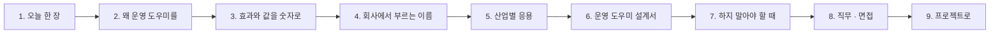

# 4단계 · 정리: 오늘 한 일의 의미 · 효과 · 실전 응용

- 교시: 8교시 17:10~17:45 (35분, 바이브 코딩 발표 10분 뒤) · 자료: 이 문서 + [개요](00-DAY79-OVERVIEW.md) 30장
- 이 시간이 끝나면: 오늘 1~3단계에서 한 일이 **무엇을 위한 것이었는지**, 숫자로 **무엇이 달라졌고 무엇을 치렀는지**, 회사에서는 같은 생각을 **어떤 이름과 도구로** 쓰는지 말할 수 있고, 단위 프로젝트 · 최종 프로젝트에 무엇을 가져갈지 정할 수 있다.
- 숫자: 오늘 교안의 실측(강사 노트북, 11/01 정답 워크플로우 1회)입니다. "예시"라고 적은 계산은 가정을 둔 어림입니다.

## 0. 이 시간 (35분)

| 시간 | 절 | 하는 일 |
| --- | --- | --- |
| 17:10~17:15 | 1 · 2 | 오늘 한 장, 왜 운영 도우미를 |
| 17:15~17:20 | 3 | 오늘 숫자로 본 효과와 값, 한 달로 보면 (예시) |
| 17:20~17:28 | 4 · 5 | 같은 생각의 업계 이름 · 도구, 산업별 응용 예 |
| 17:28~17:33 | 6 · 7 | 운영 도우미 설계서, 하지 말아야 할 때 |
| 17:33~17:40 | 8 · 9 | 직무와 면접 질문, 프로젝트 체크리스트 |
| 17:40~17:45 | 10 · 토론 | 다음 일차와의 연결, 질문 둘 |

## 1. 오늘 한 장

| 단계 | 한 일 | 오늘 숫자 |
| --- | --- | --- |
| 1단계 · 운영 사실 | 출처 둘러보기, 사실 하나로, 기간, 영역별 상태, 출처가 멈추면 | 기준 **666 · 칸 없음 · 0/5** → 357 · 0.0588 · 여섯 영역 · **5/5**, 기간 넷 (10/26 비율 `null`), 🔴 셋 · 🟡 셋, 사용량 출처가 멈추면 **500 → 200 · `unknown`** |
| 2단계 · 질문 답변 | 라우터 · 거절, 숫자 확인, 질문을 바꾸면, LLM 라우터, 감사 기록 | 기준 챗봇 **0/6** ("다시 실행해 드리겠습니다") → 3/6 → **6/6** (작업 거절 0.0초), 말투 여섯 중 불편 둘, LLM 라우터 5/5 (phrasing 4/6), 감사 3줄 |
| 3단계 · 브리핑과 평가 | 브리핑, LLM 요약, 아침이 바뀌면, 골든 질문 평가, 평가 관문 | 먼저 볼 것 셋 · 할 일 셋 (LLM 없음), 요약은 셋 중 하나만, 사람이 일한 뒤 빨강 하나, 골든 **8/8 · score 1**, 관문 fail → `eval_below` 알림 |

## 2. 왜 운영 도우미를

> **생활 속 예 · 병원의 인수인계.** 잘 돌아가는 병동은 사고가 난 뒤가 아니라 **아침 인수인계**에서 위험을 잡습니다. 인수인계가 간호사 한 사람의 기억에만 있으면 그 사람이 쉬는 날 빈칸이 생깁니다. 그래서 양식 · 색 자석 · 기록부 · 모의 시험을 둡니다. 개요 28장 "병원 아침으로 본 오늘 하루" 표도 함께 봅니다.

| 운영 담당자가 출처를 하나씩 열면 | 사실 · 도우미 · 브리핑으로 하면 |
| --- | --- |
| 여섯 곳을 여는 데 아침 시간 (빠뜨리는 곳이 생김) | 사실 한 번 0.1초, 영역 여섯 |
| 대시보드에 없는 칸은 "괜찮다" (parked · 카나리) | 영역마다 칸이 있음, 모르면 ⚪ |
| 같은 오류율이 화면마다 다름 | 정의는 사실 한 곳 (77일차 숫자 그대로) |
| "괜찮아?"에 사람마다 다른 답 | 기준표로 🔴 · 🟡 |
| 챗봇이 "해 드리겠습니다" | 작업 요청은 LLM 앞에서 거절, 런북 안내 |
| 무엇부터 볼지 그날 기분 | 먼저 볼 것 셋 · 정해진 할 일 |
| 도우미를 고친 뒤 "잘 되겠지" | 골든 질문 평가 · 관문 |

**오늘의 원칙 세 줄**: 숫자 · 상태는 Code가, 글은 LLM이, 작업은 사람이. 운영 도우미는 **읽기만** 하고, 모르는 것은 모른다고 말합니다.

## 3. 효과와 값을 숫자로

### 3.1 오늘 실측 전 · 후

| 무엇 | 전 (팀의 기준) | 후 | 바꾼 것 |
| --- | --- | --- | --- |
| 지난주 실행 | 666 · 3.153… | 357 · 0.0588 | 기간 · 77일차 정의 |
| 영역 | 넷 (칸 일부) | 여섯 + 색 | 무엇을 물을지 먼저 |
| 출처가 멈춘 아침 | 사실 전체 500 | 다섯 영역 + `unknown` | `neverError` · 모르는 것은 `null` |
| "DLQ 1번 다시 돌려 줘" | "다시 실행해 드리겠습니다" | 거절 `read_only` 0.0초 | Code 갈래 |
| 점심 메뉴 | 추천 | 거절 0.1초 | 운영 밖 갈래 |
| 카나리 질문 | 오류율 · 알림을 섞음 | 62.5% 대 7.73% | 그 영역 사실만 |
| "장애 났어?" | (낱말 라우터) 거절 | `runs`로 답 (LLM 라우터) | 낱말이 모를 때만 LLM |
| 무엇부터 | 없음 | 실행 · DLQ · 릴리스 + 할 일 | 브리핑 규칙 |
| 도우미가 괜찮나 | 모름 | 골든 8/8 · 관문 | 평가 |

**치른 값**:

- **시간 · 비용**: 질문 하나에 LLM 한 번(1~3초), LLM 라우터를 거치면 두 번(2~5초). 평가는 질문마다 LLM — 골든 8개에 3.9초. 사실 · 상태 · 브리핑 표는 0.1~1초 · 0원.
- **불편**: 낱말 라우터는 "장애"를 거절했습니다. 안전한 쪽의 실패지만 사용자는 다시 물어야 합니다.
- **남은 빈틈**: 숫자 확인 · 평가 모두 "숫자는 맞고 뜻이 틀린 답"(parked 2 · 대기 1을 거꾸로)을 통과시켰습니다. 사람의 검토와 골든 질문을 늘리는 일이 남습니다.
- **평가의 부작용**: 평가가 남긴 알림이 다음 평가의 답을 바꿨습니다. 평가 순서 · 처음 상태를 관리하는 일이 생깁니다.

### 3.2 한 달로 보면 (예시)

가정: 운영 담당자 한 명이 평일 20일 아침마다 여섯 출처를 여는 데 15분, 사실 · 브리핑으로는 3분. 도우미에게 하루 20번 묻고, 질문 하나의 LLM 비용은 오늘 단가로 1원 안팎.

| | 출처를 하나씩 | 도우미 · 브리핑 (예시) |
| --- | --- | --- |
| 아침 점검 시간 | 15분 × 20일 = 5시간 | 3분 × 20일 = 1시간 |
| 놓치는 것 | 대시보드에 칸이 없는 영역 | 영역 여섯이 늘 보임, 모르면 ⚪ |
| 잘못된 작업 | 챗봇의 "해 드리겠습니다"를 믿는 일 | 0 (거절 · 런북) |
| LLM 비용 | 0 | 하루 20질문 × 20일 = 400질문 — 몇백 원 |

- 숫자는 가정입니다. 그래도 **아침 시간 · 놓친 위험 · LLM 비용**을 같은 표에서 말할 수 있다는 것이 사실과 감사 기록을 남긴 효과입니다.

## 4. 회사에서는 같은 생각을 이렇게 부른다

| 오늘 한 것 | 업계 이름 | 쓰는 도구 · 표준 (예) |
| --- | --- | --- |
| 출처 여섯 · 영역 | 운영 신호, golden signals | Google SRE, RED · USE 방법 |
| 사실 하나로 · 정의 한 곳 | semantic layer, metrics layer | dbt Semantic Layer · Cube · LookML |
| 기간 · 지금, 0과 `null` | window vs point-in-time, missing data | Prometheus range · instant query |
| 영역별 상태 | health check, RAG status, SLO | Grafana · Datadog 상태 위젯, SLO 대시보드 |
| 출처가 멈추면 | graceful degradation, partial failure | 서킷 브레이커 · 타임아웃 · fallback |
| 운영 도우미 · 질문 답변 | ChatOps, AIOps, ops copilot | Slack 봇 · PagerDuty · Datadog Bits AI |
| 라우터 · LLM 라우터 | intent classification, semantic routing, model cascade | Rasa · LangChain router · 임베딩 라우팅 |
| 작업 거절 · 읽기만 | guardrails, least privilege, human-in-the-loop | NeMo Guardrails · Guardrails AI · 권한 분리 |
| 숫자 확인 | groundedness · faithfulness check | RAGAS faithfulness · 사내 검증기 |
| 감사 기록 | audit log, LLM observability | Langfuse · LangSmith · Helicone |
| 브리핑 · 할 일 | on-call handoff, runbook | PagerDuty runbook · 인수인계 문서 |
| 골든 질문 평가 · 관문 | eval set, regression eval, eval gate | OpenAI Evals · promptfoo · DeepEval · CI 평가 |
| `tops` | 운영 CLI · TUI 대시보드 | `k9s` · `htop` 같은 터미널 화면 |

- 오늘은 n8n 워크플로우 · 작은 데이터 API · `flow.py`로 직접 만들었습니다. 회사에서는 위 도구가 대신하는 경우가 많습니다. 그래도 **무엇을 물을지(영역), 무엇을 믿을지(정의), 무엇을 하면 안 되는지(거절), 언제 괜찮다고 할지(기준 · 관문)**는 오늘처럼 사람이 정합니다.

## 5. 산업별 응용 (예)

아래는 오늘 한 일을 다른 업무에 옮긴 예입니다 (실제 특정 회사의 사례가 아니라 흔한 모양).

| 업무 | 오늘의 무엇을 | 이렇게 |
| --- | --- | --- |
| 사내 헬프데스크 AI (72~79일차) | 사실 · 브리핑 · 평가 | 당번이 아침마다 FAQ 실패 · DLQ · 비용 · 카나리를 한 장으로, 바꿀 때마다 골든 질문 |
| 쇼핑몰 · 커머스 운영 | 영역별 상태 · 거절 | 주문 실패율 · 결제 오류 · 재고 동기화 · 광고비를 색으로, "환불해 줘"는 도우미가 거절하고 담당자에게 |
| 콜센터 · CS | 라우터 · 감사 | 상담원이 묻는 운영 질문을 영역으로, 무엇을 자주 묻는지 보고 매뉴얼 개선 |
| 클라우드 · 플랫폼 팀 (SRE) | 사실 · 출처가 멈추면 | 모니터링 · 배포 · 비용 출처를 모은 ChatOps 봇, 출처 하나가 죽어도 나머지 상태 |
| 제조 · 물류 관제 | 브리핑 · 아침이 바뀌면 | 라인별 불량률 · 설비 알림 · 출하 지연을 아침 브리핑으로, 조치 뒤 다시 |
| 금융 · 의료 (규제) | 읽기만 · 감사 · 평가 관문 | AI 도우미는 조회만, 질문 · 답을 모두 기록, 모델을 바꿀 때 평가 점수로 승인 |

**토론 거리**: 내 회사(또는 가고 싶은 회사)의 운영 하나를 골라, "영역 여섯과 도우미가 절대 하면 안 되는 일 셋"을 정해 봅니다.

## 6. 운영 도우미 설계서 (프로젝트용 틀)

오늘의 AGENTS.md 3절과 `my-work/OPS.md`가 운영 도우미 설계서였습니다. 단위 · 최종 프로젝트에서도 이 틀로 한 장을 씁니다.

| 칸 | 정할 것 | 오늘의 예 |
| --- | --- | --- |
| 영역 | 무엇을 물어야 하나 | 실행 · 알림 · DLQ · 품질 · 비용 · 릴리스 |
| 출처 · 정의 | 어디서 · 어떻게 세나 · 기간인가 지금인가 | `/logs/query` · 77일차 정의 · 기간은 실행에만 |
| 상태 기준 | 🔴 · 🟡의 선, 모르면 | 오류율 > 0.01 · parked > 0 · 비교 불가는 🟡 |
| 하면 안 되는 것 | 작업 낱말 · 운영 밖 · 거절 말 | 재처리 · 롤백 · 비워 줘 → `read_only` + 런북 |
| 근거 | 답에 쓸 사실 · 숫자 확인의 허용 형식 | 그 영역만 · ×100 · 버전 통째로 |
| 먼저 볼 것 · 할 일 | 순서 · 영역마다 런북 한 줄 | red 다음 yellow 앞 3개 |
| 평가 | 골든 질문 · 기준 · 실패하면 | 8개 · 0.9 · `eval_below` 알림 |
| 기록 | 감사 기록의 칸 · 보관 · 볼 사람 | 질문 · 영역 · 라우터 · 거절 이유 |

- 설계서가 없으면 "도우미가 잘 답한다"를 말할 수 없습니다. **물을 것 · 믿을 것 · 하지 않을 것 · 시험이 있어야 "괜찮다"고 말할 수 있습니다.**

## 7. 하지 말아야 할 때 (흔한 실수)

| 하기 쉬운 일 | 왜 위험한가 | 대신 |
| --- | --- | --- |
| 사실 전부를 LLM에게 "알아서 답해" | 숫자를 섞고 지어냄 | 라우터 · 그 영역만 · 숫자 확인 |
| 숫자 · 색을 LLM이 정함 | 같은 아침에 다른 답 | Code · 기준표 |
| 모르는 것을 0 · 초록으로 | 92%인데 🟢 | `null` · ⚪ · 전체는 적어도 🟡 |
| 도우미에게 작업 권한을 줌 | "해 드리겠습니다"가 진짜가 됨 · 사고 | 읽기만, 작업은 런북 · 사람 |
| "작업은 거절해"를 지시문에만 | 가끔 어김 | LLM 앞 Code 갈래 |
| 숫자 확인을 믿고 끝 | 뜻이 틀린 답이 통과 | 평가 · 사람 검토 |
| 요약만 보고 회의 | 급한 영역이 빠짐 | 표 · 먼저 볼 것은 Code |
| 초록만 보고 "해결" | 한도를 바꾼 것을 고친 줄 앎 | 무엇을 했는지 함께 |
| 평가 없이 프롬프트 · 모델을 바꿈 | 조용히 나빠짐 | 골든 질문 · 관문 |

## 8. 직무와 면접

오늘 한 일은 다음 직무들이 날마다 하는 일입니다: **SRE · 플랫폼 · DevOps 엔지니어, AI · LLM 애플리케이션 엔지니어, MLOps · LLMOps 엔지니어, 데이터 · 분석 엔지니어(지표 정의), 운영 · CS 자동화 담당, 업무 자동화(n8n · RPA) 개발자.** 채용 공고의 "운영 대시보드 · 모니터링", "ChatOps · 사내 AI 봇", "LLM 평가 · 가드레일", "지표 정의 · 시맨틱 레이어", "온콜 · 런북"이 오늘 내용입니다.

면접에서 흔히 받는 질문과 오늘 숫자로 답하는 법:

1. "여러 시스템의 운영 데이터를 한 대시보드로 모을 때 무엇을 먼저 정하나요?"

계산보다 **물어야 할 영역**을 먼저 정했습니다. 실행 · 알림 · DLQ · 품질 · 비용 · 릴리스 여섯이고, 기존 대시보드는 품질 · 릴리스 칸이 없어 parked 2건과 카나리를 놓쳤습니다. 그다음 정의를 한 곳(사실)에 두었습니다 — 오류율은 지난번 보고서와 같은 정의라 357건 중 0.0588로 같은 숫자가 나왔습니다. 기간 숫자와 지금 숫자를 나누고, 모르는 값은 0이 아니라 `null`로 둡니다.

2. "출처 중 하나가 장애일 때 대시보드는 어떻게 동작해야 하나요?"

나머지 영역은 그대로 보여 주고, 멈춘 영역은 "모름"으로 표시합니다. 오늘 사용량 출처를 멈추자 처음 판은 사실 전체가 500이었고, 고친 판은 200에 `cost: null` · `sources_down: ["cost"]` · 상태 `unknown`을 냈습니다. 비용을 0으로 적으면 초록으로 보이는데 실제로는 예산의 92%를 쓴 날이었습니다. 전체 상태도 빨강이 없더라도 모르는 영역이 있으면 적어도 노랑입니다.

3. "운영 챗봇이 위험한 작업을 하지 않게 하려면?"

세 겹으로 막았습니다. 쓰는 API를 아예 부르지 않고(권한), 작업 낱말("다시 돌려 · 롤백해 · 꺼 줘")이 있으면 LLM에게 가기 전에 Code가 거절하고(0초), 지시문에도 적습니다. 기존 챗봇은 "DLQ 1번 작업을 다시 실행해 드리겠습니다"라고 답했는데, 실제로는 아무것도 실행하지 않아 운영자가 된 줄 알 수 있었습니다. 거절 말에는 런북과 담당자를 넣었고, 거절도 감사 기록에 남깁니다.

4. "LLM이 숫자를 지어내지 않게 하려면? 그걸로 충분한가요?"

질문의 영역 사실만 주고, 답의 숫자가 모두 그 사실 안에 있는지 Code로 확인합니다 (×100 · 반올림 · 버전은 허용). 지어낸 숫자는 잡지만 충분하지 않습니다 — 오늘 "parked 2 · 대기 1"을 거꾸로 말한 답이 숫자 확인을 통과했습니다. 그래서 골든 질문 평가를 두고, 틀리기 쉬운 질문을 골든 세트에 더하고, 중요한 답은 사람이 검토합니다.

5. "LLM 기반 기능을 바꿀 때 품질이 떨어지지 않았는지 어떻게 아나요?"

정답을 아는 골든 질문으로 평가하고 점수에 관문을 둡니다. 오늘 8개 질문에 영역 · 거절 · 기대 숫자 · 근거 넷을 보고 8/8 · score 1, 기준 0.9 아래면 실패와 알림. 평가 자체도 시험했습니다 — 일부러 틀린 기대를 넣으면 잡아내고, 빈 목록은 400. 그리고 평가가 남긴 알림이 다음 평가의 답을 바꾼 일이 있어, 처음 상태에서 순서를 정해 돌립니다.

## 9. 프로젝트로 가져갈 것

단위 프로젝트(80~82일차) · 최종 프로젝트(85일차~)의 워크플로우에 아래를 넣으면 "운영할 수 있는 프로젝트"가 됩니다.

- [ ] 운영 도우미 설계서 한 장 (6절 틀): 영역 · 출처 · 정의 · 상태 기준 · 하면 안 되는 것 · 평가 · 기록
- [ ] 사실 웹훅 하나 (정의는 한 곳), 기간은 기간 숫자에만, 모르면 `null`
- [ ] 영역별 상태 (기준표) · 출처가 멈춰도 200 · `unknown`
- [ ] 질문 답변: 라우터 · 그 영역만 · 작업 · 운영 밖은 LLM 앞에서 거절 · 숫자 확인 · 감사 기록
- [ ] 아침 브리핑: 먼저 볼 것 · 정해진 할 일 (Code), 요약은 덧붙이는 말
- [ ] 골든 질문 평가 · 관문 (기준은 입력으로, 실패하면 알림), 처음 상태에서
- [ ] `OPS.md` · `TEST-REPORT.md`, 터미널 도구(`tops`)로 당번의 아침

## 10. 다음 일차와의 연결

| 일차 | 오늘의 무엇을 잇나 |
| --- | --- |
| 80~82 | 단위 프로젝트 — 팀마다 64~79일차의 워크플로우를 묶은 서비스, 오늘의 운영 도우미가 그 서비스의 운영 부분 (발표 때 "지금 괜찮나?"를 시연) |
| 85~ | 최종 프로젝트 — 9절 체크리스트를 팀 워크플로우에 |

## 토론 (5분)

1. 오늘 도우미는 "읽기만" 했습니다. DLQ 재처리처럼 런북이 분명한 작업이라면, 사람이 **승인 버튼**을 누르는 방식으로 도우미가 해도 될까요? 무엇이 더 있어야 할까요?
2. "장애 났어?"를 거절하는 낱말 라우터와, 가끔 엉뚱한 영역을 고르는 LLM 라우터 중 우리 팀의 아침에는 어느 쪽이 나을까요?

## 정리

- [ ] 운영 도우미는 "지금 괜찮나? 무엇부터 볼까?"에 답하고 **읽기만** 한다
- [ ] 먼저 물을 영역을 정하고, 정의는 사실 한 곳에 (기준 666 · 칸 없음 vs 357 · 여섯 영역)
- [ ] 기간과 지금을 나누고, 0과 `null`을 구분하고, 출처가 멈추면 `unknown`
- [ ] 숫자 · 상태는 Code, 글은 LLM, 작업은 사람 — 거절은 LLM 앞에서 (0/6 → 6/6)
- [ ] 숫자 확인은 지어낸 숫자만 잡는다 — 뜻은 평가 · 사람이
- [ ] 브리핑의 순서 · 할 일은 규칙으로, 초록이 된 까닭을 함께 말한다
- [ ] 골든 질문 평가 · 관문으로 도우미를 시험한다 (8/8, fail → 알림), 평가가 바꾸는 상태까지
