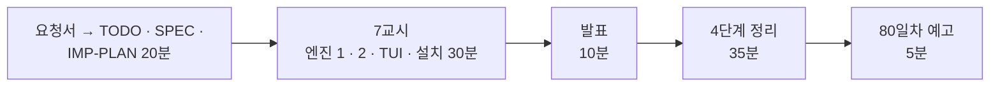

# 7·8교시 · 바이브 코딩 (`tops`)

- 교시: 7교시 16:00~16:50 (각자 만들기), 8교시 17:00~17:50 (발표 10분 · [4단계 정리](04-STAGE4-WRAPUP.md) 35분 · 예고 5분)
- 과제: [VIBE-REQ-TOPS](../../Last3Mon/79/VIBE-REQ-TOPS.md)(요청서, 요청의 말 ①~⑫) → [VIBE-Q-TOPS](../../Last3Mon/79/VIBE-Q-TOPS.md)의 8단계: `Doc/TODO.md` → `Doc/SPEC.md` → `Doc/IMP-PLAN.md`(엔진 · TUI 단계) → 단계별 구현 → 확인 → `uv tool install` → 다른 폴더에서 사용 → 수업 뒤 `VIBE-A-TOPS.md` 공개
- 요구 14개(R1~R14). 50분 안에는 **엔진 1단계(R1 · R2 · R3 · R5 · R7 · R13 · R14) + 엔진 2단계(R4 · R6) + TUI 1단계(R11 · R12) + 설치**, 나머지(R8 지난 도구, R9 평가 관문, R10 감사)는 IMP-PLAN의 다음 단계로 집에서.
- 72일차 `tbench`부터 78일차 `tcheck`와 같은 흐름입니다: 사람의 말(요청서)을 **확인할 수 있는 요구**로 바꾸는 일을 학생이 먼저 하고, VIBE-Q는 그 다음 단계(비교 대상)로 씁니다. 에이전트에게는 처음 요청 한 번과 "확인했고 commit 했어. 다음 단계." 한 줄만 씁니다.
- 오늘은 `tops`: 오늘 n8n 운영 도우미(`my-ops-facts` · `my-ops-ask` · `my-ops-brief` · `my-ops-eval`)를 **터미널에서 보는** 도구. 색 · 숫자는 n8n이 정한 그대로, 질문 · 거절 · 브리핑 · 평가 관문 · 감사, 지난 도구(`tlog` · `tcheck`)를 부품으로, TUI. **읽기만** 합니다.

> **생활 속 예 · 회진 도는 의사의 손바닥 현황판.** 오늘 병원(n8n)에 인수인계 시스템을 만들었습니다. 회진하는 의사는 간호사실까지 오지 않고 손바닥 화면으로 봅니다. 손바닥 화면이 따로 판정하면 안 되고(간호사실이 빨강이면 손바닥도 빨강), 손바닥으로는 **보기만** 하고 처방은 하지 않습니다.

> 이 문서는 7 · 8교시 진행 문서입니다. 8교시의 정리 35분은 [04-STAGE4-WRAPUP](04-STAGE4-WRAPUP.md)으로 합니다.

## 1. 7교시 · 각자 만들기 (50분)

| 시간 | 단계 | 확인 |
| --- | --- | --- |
| 16:00~16:09 | 0 준비 · 1 요청서 → `Doc/TODO.md` (에이전트 없이) | 할 일 ①~⑫ · 꼭 / 나중 |
| 16:09~16:15 | 2 `Doc/SPEC.md` → VIBE-Q 요구 표(R1~R14)와 비교 · commit | 요구마다 확인 방법 (영역 일곱 줄 · 종료 코드 4 · 작업 거절 · 읽기만 테스트) |
| 16:15~16:20 | 3 `Doc/IMP-PLAN.md` (엔진 1~3단계 · TUI 1단계 · 설치) · commit | 단계마다 체크리스트 |
| 16:20~16:44 | 4 구현: 엔진 1단계 → 엔진 2단계 → TUI 1단계, 막히면 5 문제 해결 팁 | 단계마다 `pytest` · 직접 실행 · commit |
| 16:44~16:50 | 6 확인 · 7 `uv tool install --editable .` · 8 다른 폴더에서 `tops` | `tops status` = n8n 브리핑의 색 · 숫자 |

| 볼 것 | 막혔을 때 한마디 |
| --- | --- |
| TODO · SPEC 없이 VIBE-Q를 통째로 붙여 넣었나 | "요청서로 Doc/TODO.md부터. 일곱 줄 · 종료 코드 4가 SPEC에 없으면 맞았는지 모릅니다" |
| IMP-PLAN이 한 덩어리 · 첫 요청에 14개 | "엔진 1단계만. 단계마다 확인 · 체크 · commit" |
| 색이 n8n 브리핑과 다름 | "health 그대로, 기준값(0.01 · 0.8)은 n8n에만" |
| 오류율이 `0.0588%` · `588%` | "AGENTS.md 3절 브리핑 표의 형식: ×100 · 두 자리" |
| 출처가 멈춘 날 비용이 `$0` · 🟢 | "null이면 응답 없음 · ⚪" |
| tops에 재처리 · 리셋 기능이 생김 | "읽기만 — 부를 수 있는 주소 목록, 그 밖은 막는 테스트" |
| 테스트가 진짜 n8n을 부름 | "가짜 서버(http.server)와 n8n 응답 사본으로" |
| n8n을 끄면 traceback | "cannot read · 종료 코드 1" |
| 실행해 보지 않고 다음 요청 | "에이전트가 됐다고 해도 직접 `uv run tops status; echo $?`" |

정답 예(R1~R14를 모두 넣은 `tops`와 정답본 `VIBE-A-TOPS.md`)는 수업 뒤 공개됩니다.

## 2. 8교시 · 발표 (10분)

- 1~2명. **`tops status`와 n8n 브리핑의 색 · 숫자가 같다는 것을 보여 줄 수 있는 사람**, n8n을 끄거나 사실 파일만 주고 `tops ui`의 "not available" 탭을 보여 줄 수 있는 사람을 먼저 고릅니다.
- 3분 발표 · 2분 질문: **내 SPEC과 VIBE-Q가 달랐던 곳** / IMP-PLAN을 어떻게 나눴나 / 처음 요청 · 고쳐 달라는 요청문 / 에이전트가 틀린 곳(다시 판정 · 숫자 형식 · 0과 null · 쓰는 주소) / 시연.

## 3. 강사 정리 (8교시 4단계 정리 안에서)

| | n8n (오늘 Lab) | tops |
| --- | --- | --- |
| 사실 · 상태 | `my-ops-facts` (Lab 01) | `tops status` — `health` 그대로, 숫자는 형식만 (R1 · R2 · R7) |
| 질문 · 거절 | `my-ops-ask` (Lab 02) | `tops ask` — 영역 · 라우터 · 거절 이유 · 숫자 확인 (R4) |
| 브리핑 | `my-ops-brief` (Lab 03) | `tops brief` (R6) |
| 평가 관문 | `my-ops-eval` (Lab 03 과제) | `tops eval` — fail이면 종료 코드 4 (R9) |
| 감사 | `/audit` (Lab 02 과제 2) | `tops audit` (R10) |
| 지난 도구 | — | `tops tools` — `tlog slo` · `tcheck` (R8) |
| 읽기만 | 쓰는 API를 부르지 않음 · 작업 거절 | 주소 목록 `READ_ONLY` + 테스트 (R5) |

- 풀이 거리: 강사 본은 실제 n8n에서 일곱 줄 · 종료 코드 4 · 0.19초, `tops tools`의 `tlog slo`가 **357 runs**로 같은 지난주를 셌습니다 — 정의를 복사하지 않고 그 도구를 불렀기 때문입니다. TUI 시험에서 "부른 주소는 다섯뿐"을 검사했다가 도구 탭의 `tlog`가 실행 기록을 읽어 실패했습니다 → 읽기만의 뜻은 "읽는 주소만"이 아니라 **"바꾸는 주소가 0건"**.
- `tops audit`를 평가 뒤에 보면 평가의 질문까지 섞여 11줄 — Lab 03 과제 2의 "평가가 상태를 바꾼다"와 같은 이야기.

## 4. 강사 바이브 코딩 (시간이 남으면 · 수업 뒤, 15분)

| 주제 | 요청문 요지 | 보여 줄 것 |
| --- | --- | --- |
| 아침 cron | "평일 08:30에 `tops status`가 4면 `tops brief`를 파일로 남기는 cron 한 줄과 설명" | 종료 코드로 아침 점검을 자동으로 |
| 승인 버튼 (생각해 보기) | "`tops ui`의 DLQ 줄에서 `[a]`를 누르면 런북 문장과 담당자만 보여 주고 아무것도 실행하지 않는 화면" | 읽기만을 지키면서 다음 할 일을 안내 |
| 팀 화면 | "`--n8n`을 팀 VM 주소로, 영역마다 마지막으로 바뀐 시각" | 단위 프로젝트의 운영 화면 |

걸린 시간과 결과를 `Last3Mon/79/VIBE-A-TOPS.md`에 적어 둡니다.

## 5. 보충 · 팁 (읽을거리, 4단계 정리 7절과 함께)

| 팁 | 설명 |
| --- | --- |
| 요청서 → 요구가 먼저 | 확인 방법(일곱 줄 · 종료 코드 · 거절 줄)이 있는 요구가 있어야 에이전트의 "완료"를 판단할 수 있음 |
| 기대 출력은 이미 있다 | 오늘 브리핑 표(`cases/lab03.json`)와 같은 숫자 — SPEC과 테스트에 그대로 |
| n8n의 답을 사본으로 | `call my-ops-facts …`의 응답을 `tests/data/`에 두면 n8n 없이도 시험 |
| 판정은 한 곳 | 색 · 거절은 n8n에만, tops는 보여 주기만 |
| 읽기만은 주소 목록으로 | "조심"은 약속이 아님 — 테스트로 확인할 수 있는 목록 |
| 0과 `null` | 모르는 것을 좋게 보이지 않기 |
| 지난 도구는 명령으로 | 복사하면 정의가 또 한 벌 |
| 종료 코드로 말한다 | 0 · 1 · 2 · 4 — cron · 스크립트가 다음 일을 정함 |
| 단계마다 `git commit` | 에이전트가 망가뜨려도 돌아갈 곳 |

## 6. 80일차 예고 (5분)

- 오늘: 72~78일차의 운영 데이터를 사실 · 상태로 모으고, 묻고 답하고 막고, 브리핑하고, 도우미를 시험했습니다. 다음 수업(80~82일차): **단위 프로젝트** — 팀마다 64~79일차의 워크플로우를 묶어 하나의 서비스로 만들고, 오늘의 운영 도우미를 그 서비스의 운영 부분으로 씁니다. 자세한 일정은 [80-82-Project](../80-82-Project/README.md).
- 64~79일차 `my-work/*`, `~/vibe/*`(`tops` 포함)는 지우지 마세요. 팀 구성 전에 "내가 가장 잘 만든 워크플로우 하나"를 골라 옵니다.

## 확인 (강사)

- [ ] 16:00 요청서 → TODO(에이전트 없이) → SPEC → IMP-PLAN 20분을 지켰다, 16:20부터 엔진 1단계.
- [ ] 7교시 시작 전 n8n에 `my-ops-facts`(Lab 01 과제 1 이상) · `my-ops-ask`가 게시돼 있어 색 비교 · 질문을 할 수 있다.
- [ ] 수업 뒤: 요청이 있을 때 학생 저장소에 정답(LAB-A · `answers/` · VIBE-A · `tops/`)을 올린다.
- [ ] 발표자 1~2명, 강사 정리 표, 팁, 예고.
- [ ] 수업이 끝날 때 학생들의 데이터 API가 운영 아침 상태인지 (`morning --reset`, `doctor`).
