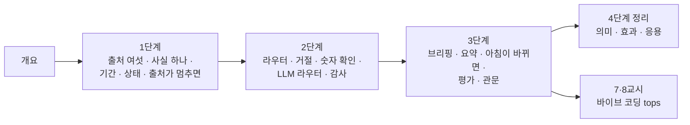

# 79일차 · 운영 데이터 기반 Workflow Ops Assistant (바이브 코딩)

- 일자: 2026-11-04 (79일차)
- 교과목: 노코드 멀티 에이전트 워크플로우 설계 및 운영
- 단원: AI 워크플로우 운영 및 관리 역량 강화
- 학습 내용: 운영 데이터 기반 Workflow Ops Assistant 구현
- 실습 폴더: [Last3Mon/79](../../Last3Mon/79/README.md) · 하루 수강 안내: [LECTURE-79.md](../../Last3Mon/79/LECTURE-79.md)
- 실습 환경: 65일차 n8n 2.42.6 + OpenAI API(`gpt-4.1-mini`) + 79일차 데이터 API(운영 아침 상태) + **CLI 코딩 에이전트**
- **실습 준비: [00-DAY79-PREP.md](00-DAY79-PREP.md) (수업 전날까지 1~2절 완료)**
- 72일차부터의 방식: 단계마다 **1교시 강의 + 1교시 실습(5개: 예제 3 · 과제 2)**, 8교시는 발표와 4단계 정리.

## 오늘의 시간표

| 교시 | 시간 | 내용 | 자료 |
| --- | --- | --- | --- |
| 1 | 09:00~09:50 | 오늘의 개요 · 1단계 강의 · 운영 사실 | [개요](00-DAY79-OVERVIEW.md) 1~14장, [1단계](01-STAGE1-OPS-FACTS.md) |
| 2 | 10:00~10:50 | Lab 01 실습 5개 (출처 둘러보기 · 운영 사실 · 기간 · 영역별 상태 · 출처가 멈추면) | [Lab 01](../../Last3Mon/79/LAB-01-Q-OPS-FACTS.md) |
| 3 | 11:00~11:50 | 2단계 강의 · 질문 답변 | 개요 15~21장, [2단계](02-STAGE2-OPS-ASK.md) |
| 4 | 12:00~12:50 | Lab 02 실습 5개 (라우터 · 거절 · 숫자 확인 · 질문을 바꾸면 · LLM 라우터 · 감사 기록) | [Lab 02](../../Last3Mon/79/LAB-02-Q-OPS-ASK.md) |
| - | 13:00~14:00 | 점심 |  |
| 5 | 14:00~14:50 | 3단계 강의 · 브리핑과 평가 | 개요 22~28장, [3단계](03-STAGE3-OPS-BRIEF.md) |
| 6 | 15:00~15:50 | Lab 03 실습 5개 (브리핑 · LLM 요약 · 아침이 바뀌면 · 골든 질문 평가 · 평가 관문) | [Lab 03](../../Last3Mon/79/LAB-03-Q-OPS-BRIEF.md) |
| 7 | 16:00~16:50 | 바이브 코딩 · `tops`: 요청서 → TODO → SPEC → IMP-PLAN → 만들기 → 설치 | [VIBE-REQ-TOPS](../../Last3Mon/79/VIBE-REQ-TOPS.md) → [VIBE-Q-TOPS](../../Last3Mon/79/VIBE-Q-TOPS.md), [진행](05-VIBE-CODING.md) |
| 8 | 17:00~17:50 | 바이브 코딩 발표 · **4단계 정리** (의미 · 효과 · 실전 응용) · 80일차(단위 프로젝트) 예고 | [4단계 정리](04-STAGE4-WRAPUP.md), [진행](05-VIBE-CODING.md) |

## 자료 목록

| 파일 | 내용 |
| --- | --- |
| `00-DAY79-PREP.md` | 실습 준비: n8n · 79일차 판 데이터 API 켜기, 기준 둘 게시, `flow.py morning` · `doctor` (수업 전) |
| `00-DAY79-OVERVIEW.md` | 개요 30장 (PPT 대신 Markdown, 가로줄로 장 구분, 장마다 생활 속 예 한 줄) |
| `01-STAGE1-OPS-FACTS.md` | 운영 도우미, 출처 여섯과 없는 칸, 사실 하나로(시맨틱 레이어), 기간과 지금 · 0과 `null`, 상태는 규칙으로, 출처가 멈추면 |
| `02-STAGE2-OPS-ASK.md` | 기준 챗봇의 세 실수, 라우터 · 그 영역만, 거절은 LLM 앞에서, 숫자 확인과 그 한계, 질문을 바꾸면, LLM 라우터, 감사 기록 |
| `03-STAGE3-OPS-BRIEF.md` | 브리핑 · 먼저 볼 것은 규칙으로, LLM 요약은 덧붙이는 말, 아침이 바뀌면, 골든 질문 평가, 평가 관문, 평가가 바꾸는 것 |
| `04-STAGE4-WRAPUP.md` | 8교시 35분 정리: 오늘 한 장, 왜 운영 도우미를, 효과와 값, 업계 이름 · 도구, 산업별 응용, 운영 도우미 설계서, 하지 말아야 할 때, 직무 · 면접, 최종 프로젝트 체크리스트 |
| `05-VIBE-CODING.md` | 7·8교시 바이브 코딩 진행 (`tops`), 발표, 강사 정리, 추가 바이브 코딩, 팁, 80일차 예고 |
